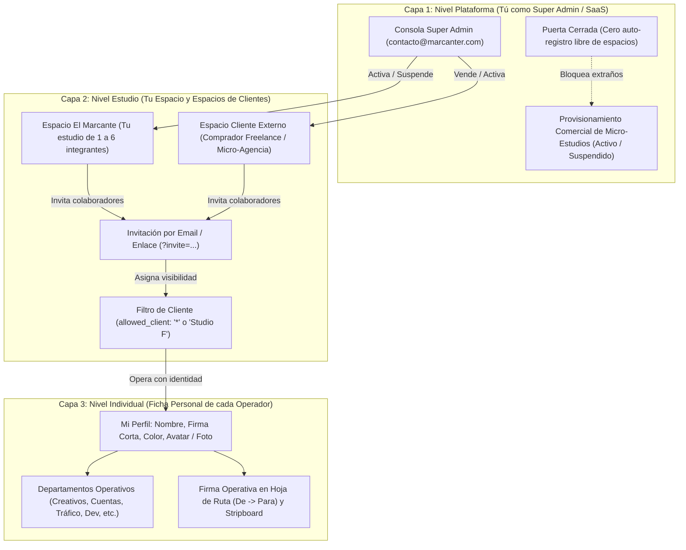

# Plan de Arquitectura e Implementación: Las 3 Capas de Trafikeitor

Este documento describe la arquitectura integral de **Trafikeitor** conectando el modelo comercial de la plataforma con la operación colaborativa de micro-estudios y la identidad de cada operador, sin romper la estructura de 11 columnas de la mesa de tráfico ni flujos existentes.

---

## 1. Visión y Matriz de Estado Actual (GAP Analysis)

### Matriz de Diagnóstico: Qué está implementado vs. Qué falta

| Capa | Característica | Estado Actual | Qué Falta para Cumplir el Modelo |
| :--- | :--- | :---: | :--- |
| **1. Plataforma** | Aislamiento por `organizationId` | ✅ **Implementado** | OTs, clientes, estados y stripboard ya se filtran y guardan por organización en SQLite. |
| **1. Plataforma** | Puerta cerrada a extraños | ⚠️ **Parcial / Abierta** | Actualmente cualquier visitante puede entrar a `/api/auth/sign-up/email` y el servidor le auto-crea un espacio gratis. Debe bloquearse el registro libre de espacios nuevos. |
| **1. Plataforma** | Consola de Super Admin | ❌ **Pendiente** | Falta la interfaz y los endpoints administrativos para que tú (`contacto@marcanter.com`) puedas ver todos los espacios, crear nuevos espacios vendidos y suspender/reactivar licencias. |
| **2. Estudio** | Invitación por email / link | ✅ **Implementado** | Endpoints oficiales de Better Auth y UI de "Mi Equipo" operativos con cuota de 6 miembros. |
| **2. Estudio** | Aceptación de invitación | ✅ **Implementado** | Flujo `?invite=...` vincula al colaborador directamente al espacio compartido. |
| **2. Estudio** | Filtro de Cliente (`allowed_client` / Caso Brigitte) | ❌ **Pendiente** | Al invitar, no hay opción de restringir a un cliente específico (`Studio F`). En el backend falta filtrar OTs, clientes y Stripboard para colaboradores restringidos. |
| **3. Individuo** | Ficha Personal (Avatar, Color, Firma) | ✅ **Implementado** | 100% nativo con Better Auth `additionalFields` y `/api/auth/update-user`. |
| **3. Individuo** | Departamentos y Firma en Hoja de Ruta | ✅ **Implementado** | Cascadas activas en `ordersCache` y `stripboardCache`. |
| **3. Individuo** | Registro inicial de colaborador | ⚠️ **Mejora** | En el modal de registro de invitados solo pide Nombre y Contraseña; conviene que el colaborador configure su Firma Corta y Color al momento de registrarse. |

---

## 2. Especificación Detallada de las 3 Capas

---

### CAPA 1: Nivel Plataforma (Tú vendiendo Espacios a otros Freelances)

#### 1.1 Aislamiento Total por Espacio (`organizationId`)
* Cada cliente que compra la aplicación (independiente o micro-agencia de 1 a 5 colaboradores) recibe su propio `organizationId`.
* Todo su catálogo de Clientes, OTs, Rutas, Archivos y Stripboard está estrictamente aislado en la base de datos SQLite.
* Ni ellos pueden ver los datos de tu estudio (El Marcante), ni pueden ver los datos de ningún otro comprador de la plataforma.

#### 1.2 Puerta Cerrada a Extraños (Zero Free-Signup)
* **El Problema Actual:** El endpoint público de registro permitía que cualquiera creara un espacio en blanco sin pagar.
* **La Solución:**
  1. En el frontend (`showAuthGate`), la pantalla por defecto es exclusivamente **"Iniciar Sesión"**.
  2. La opción **"Crear Cuenta"** se deshabilita para el público general y **solo se activa en dos circunstancias**:
     - Si la URL trae un parámetro de invitación válido (`?invite=INVITATION_ID`).
     - Si el sistema está recién desplegado en frío (cero usuarios en la base de datos) para que tú crees tu cuenta maestra inicial.
  3. En el backend (`/api/studio/*`): Si un usuario sin organización asignada intenta consumir la API, el servidor rechaza la petición con `403 Forbidden: "No tienes un espacio de trabajo asignado. Contacta al administrador."` en lugar de crearle un espacio gratis.

#### 1.3 Consola de Super Admin (`#superadmin-console-modal`)
* **Identidad Super Admin:** Tu cuenta maestra (`contacto@marcanter.com`) con `role === 'superadmin'`.
* **Ubicación en UI:** Un botón discreto en la barra superior del header (visible únicamente cuando `currentUser.role === 'superadmin'`), o activable mediante atajo de teclado.
* **Funciones de la Consola:**
  1. **Directorio de Espacios Activos:**
     - Nombre del Estudio (ej. *Estudio Gamma*, *El Marcante*).
     - Slug identificador.
     - Correo del Dueño comprador.
     - Cantidad de Integrantes activos (`X / 6`).
     - Estado de la Licencia (`active` / `suspended`).
     - Fecha de creación.
  2. **Vender / Activar Nuevo Espacio:**
     - Formulario con: Nombre del Estudio, Slug sugerido, Correo del comprador.
     - Al presionar **"Crear Espacio"**, el sistema crea la organización en Better Auth y genera un **Enlace de Activación Maestro** para enviárselo al comprador.
     - Al hacer clic en ese enlace, el comprador ingresa su contraseña, configura su perfil de Director y entra como `owner` de su nuevo espacio.
  3. **Interruptor de Suspensión (Kill Switch):**
     - Botón para alternar el estado del espacio entre `active` y `suspended`.
     - Si el estudio pasa a `suspended`, cualquier intento de entrar a `/api/studio/*` por parte de cualquier miembro de ese espacio es bloqueado inmediatamente con `403: Licencia suspendida`.

---

### CAPA 2: Nivel Estudio (Tu Espacio y Colaboradores de 1 a 5 Personas)

Tanto en tu propio estudio (*El Marcante*) como en los estudios de tus clientes que compraron la app, el flujo para armar el equipo funciona exactamente igual:

#### 2.1 Invitación por Correo / Enlace
* El dueño entra a su pestaña **"Mi Equipo / Espacio"** en el modal de usuario.
* Ingresa el correo del colaborador y selecciona su nivel de acceso.
* Se genera una invitación oficial de Better Auth con token único.
* Puede copiar el enlace directo (`https://trafico.elmarcante.com/?invite=TOKEN`) para enviárselo por WhatsApp/Slack, o esperar que le llegue el aviso.

#### 2.2 Onboarding del Colaborador
* El colaborador abre el enlace `?invite=TOKEN`.
* El modal de acceso lo recibe con un banner destacado: *"🤝 Invitación a Micro-Estudio"*.
* Llena su Nombre, su Firma Corta (`shortName`), su Contraseña, su Color y sus Departamentos.
* Al presionar "Unirse al Equipo", Better Auth lo registra, acepta la invitación (`accept-invitation`) y fija la organización como activa (`set-active`).
* Entra directamente al espacio compartido del dueño, nunca a un espacio en blanco.

#### 2.3 Filtro Opcional de Cliente (`allowed_client` — Caso Brigitte)
* **El Problema:** Tienes colaboradores internos (ej. creativos o socios) que deben ver todas las OTs, pero también colaboradoras externas o ejecutivas dedicadas a un cliente puntual (ej. Brigitte en *Studio F*) que solo deben ver su propia marca.
* **Diseño del Filtro:**
  1. **En la Invitación:**
     - El Dueño selecciona:
       - `Acceso a Clientes`:
         - `★ Todo el Estudio (*)` (predeterminado para creativos, directores, redactores).
         - O selecciona un cliente específico de la lista activa del estudio (ej. `Studio F`).
  2. **Persistencia en Base de Datos:**
     - Columna `allowed_client` en la tabla `members` e `invitations` (valor: `'*'` o el nombre/ID del cliente).
  3. **Filtrado en Servidor (`/api/studio/bootstrap`):**
     - Si el usuario logueado tiene `allowed_client !== '*'`:
       - Solo recibe en `clients` el cliente autorizado (`Studio F`).
       - Solo recibe en `orders` las OTs de ese cliente.
       - En `stripboard`, solo ve los strips asociados a OTs de ese cliente.
     - Para el Dueño y demás miembros con `*`: ven la totalidad de los clientes y el Stripboard consolidado.
  4. **Seguridad en UI (`index.html`):**
     - Si el usuario tiene cliente restringido, al abrir el modal de crear nueva OT, el campo de Cliente queda bloqueado y fijado en su marca asignada (`Studio F`), impidiendo que cree OTs para otras marcas por equivocación.

---

### CAPA 3: Nivel Individual (Ficha Personal de cada Operador)

Cada integrante (el dueño y sus 2–5 colaboradores) tiene control sobre su ficha en la pestaña **"Mi Perfil"**:

#### 3.1 Identidad Operativa
* **Nombre Completo:** Identidad formal.
* **Firma Corta (`shortName`):** La firma de 2 a 12 caracteres (ej. `Andrés J.`, `Brigitte F.`, `Carlos M.`) que se estampa automáticamente en:
  - La columna **Responsable** de la OT.
  - La casilla `sign` de la **Hoja de Ruta** cada vez que tramita un paso *De -> Para*.
  - Las tarjetas del **Stripboard**.
* **Color Personal:** Selección de uno de los 10 colores corporativos de `CLIENT_COLOR_PALETTE`. Se refleja en el punto de estado del header, sus iniciales y sus firmas.
* **Avatar / Foto:**
  - Modo Iniciales vectoriales de alto contraste.
  - Modo Ícono (8 gráficos vectoriales de oficio: Pluma, Claqueta, Vector, Megáfono, Reloj, Código, Gafas, Rayo).
  - Modo Foto de perfil subida por el usuario (redimensionada a 128x128px para optimizar almacenamiento).
* **Departamentos Operativos:** Selección de las áreas en las que opera (Creativos, Cuentas, Tráfico, Desarrollo, etc.). Determina el origen por defecto al crear nuevos pasos de ruta.
* **Seguridad:** Formulario para cambio de contraseña conectado a `/api/auth/change-password` y botón de cierre de sesión.

---

## 3. Plan de Implementación Paso a Paso (Roadmap)

### Fase 1: Puerta Cerrada a Extraños (Gating de Registro)
- [ ] Modificar `src/server/index.ts`: eliminar la auto-creación libre de organizaciones para usuarios sin invitación ni compra.
- [ ] Modificar `src/client/main.js` (`showAuthGate`): ocultar "Crear Cuenta" si no existe el parámetro `?invite=...` en la URL (excepto en primera instalación limpia).

### Fase 2: Consola de Super Admin y Control de Espacios
- [ ] En `src/server/db/schema.ts` y `index.ts`, asegurar soporte completo de `role: 'superadmin'` y columnas de estado en `studios`.
- [ ] Crear endpoints protegidos para superadmin:
  - `GET /api/admin/studios`: lista de todos los espacios y miembros.
  - `POST /api/admin/studios/create`: alta de nuevo espacio y generación de enlace de activación.
  - `POST /api/admin/studios/toggle-status`: activación / suspensión de licencias.
- [ ] Diseñar el modal `#superadmin-console-modal` en `index.html` y conectar su apertura solo para `currentUser.role === 'superadmin'`.

### Fase 3: Filtro Opcional de Cliente (`allowed_client` — Caso Brigitte)
- [ ] Modificar `schema.ts` e `index.ts` añadiendo `allowed_client` a las tablas `members` e `invitations`.
- [ ] En el modal "Mi Equipo / Espacio", agregar el selector de cliente en el formulario de invitación (`Todos (*)` o cliente específico).
- [ ] En `/api/studio/bootstrap` y `/api/studio/sync`, implementar el filtrado estricto de clientes, OTs y Stripboard según el `allowed_client` del usuario autenticado.
- [ ] En el modal de nueva OT, bloquear el campo cliente si el usuario tiene asignación fija.

### Fase 4: Onboarding Completo del Colaborador
- [ ] Enriquecer el formulario de registro de invitados (`showAuthGate`) para que ingrese Nombre, Firma Corta (`shortName`) y Color desde el primer paso.
- [ ] Pruebas E2E automatizadas:
  1. Intento de registro extraño bloqueado.
  2. Super Admin crea nuevo espacio y genera link de activación.
  3. Dueño invita colaborador con `allowed_client = 'Studio F'`.
  4. Colaborador Brigitte entra y comprueba que solo ve OTs de *Studio F*.
  5. Dueño comprueba que ve todas las marcas consolidadas en su Stripboard.

---

## 4. Decisiones Clave Validadas

1. **Super Admin:** Cuenta maestra fijada en `contacto@marcanter.com` con privilegios globales de plataforma.
2. **Caso Brigitte:** Colaborador restringido con campo de cliente preseleccionado y bloqueado en creación de OTs.
3. **Control Comercial:** Interruptor administrativo manual (Activo / Suspendido) en la consola de Super Admin para la etapa actual.
