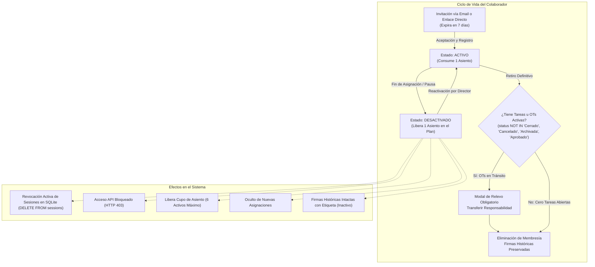
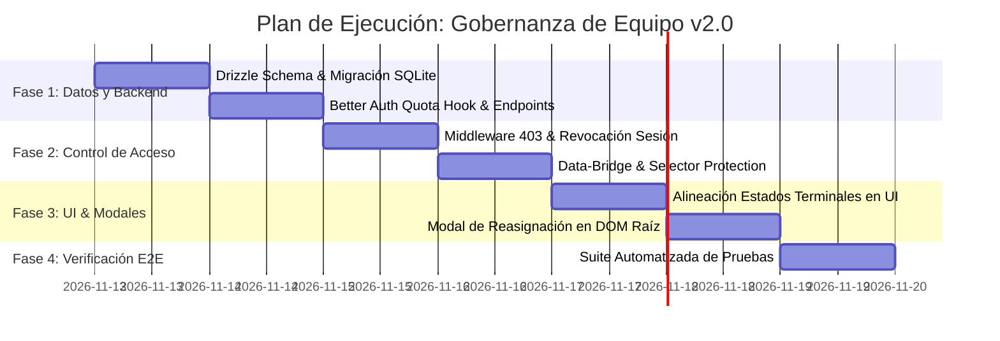

R# PLAN MAESTRO: GESTIÓN DE EQUIPO COLABORATIVO Y GOBERNANZA OPERATIVA ("MI EQUIPO")

**Versión:** 2.0.0  
**Fecha:** 2026-11-12  
**Estado:** Listo para Implementación (Aprobado tras Dictamen de Auditoría EGM v2.0 con Precisiones Operativas)  
**Estándar:** feature-spec-standard  
**Aplicación:** Trafikeitor // Sistema de Control de Tráfico Publicitario & Strips  
**Benchmark:** Wrike (Agencies & Marketing Teams) & ClickUp Workspace Governance  

---

## 1. RESUMEN EJECUTIVO & VISIÓN

En agencias de publicidad, productoras y estudios de diseño, la gestión de colaboradores difiere radicalmente de un CRUD genérico de usuarios. Existen tres imperativos legales y operativos innegociables:

1. **La Trazabilidad Histórica de Firmas es Sagrada:**  
   Una Orden de Trabajo o Hoja de Ruta aprobada hace meses debe conservar inalterada la firma de quien la tramitó (*"Aprobado para pauta en TV por Carlos R."*). La salida o desactivación de un usuario nunca debe mutar, borrar o anonimizar firmas previas ni corromper las OTs históricas.
2. **Gestión Económica de Licencias y Asientos (Seats):**  
   Poder pausar o desactivar a colaboradores (ej. freelancers por temporada o bajas laborales) para liberar cupos de licencia sin perder su historial operativo, permitiendo reactivarlos de inmediato cuando retomen actividades.
3. **Aislamiento de Confidencialidad y NDAs vía Espacios de Trabajo:**  
   Para clientes con acuerdos estrictos de no competencia (ej. dos bancos o marcas automotrices rivales), el aislamiento se resuelve de forma limpia mediante la arquitectura nativa **Multi-Workspace de Better Auth** (`setActiveOrganization`). Se descarta deliberadamente el micro-particionado de carteras dentro de un mismo espacio (ABAC) para evitar la fragmentación operativa y proteger la integridad del motor de sincronización.

Este plan estructura el módulo **"Mi Equipo / Espacio"** sobre **Better Auth** y **SQLite**, garantizando gobernanza completa, seguridad transaccional, tolerancia a desconexión y una experiencia fluida de usuario.

---

## 2. BENCHMARK COMPARATIVO: MODELO DE CICLO DE VIDA DE MIEMBROS



### Tabla de Estados de un Miembro

| Estado | Acceso al Sistema | Consume Asiento (Seat) | Nuevas Asignaciones | Firmas y Rutas Históricas |
| :--- | :---: | :---: | :---: | :--- |
| **`active`** (Activo) | Total en el estudio activo | Sí (Tope: 6 activos) | Sí (Visible en selectores) | Activas y editables por el titular |
| **`deactivated`** (Inactivo) | **Bloqueado (HTTP 403 / Sesión Revocada)** | **No (Libera cupo)** | **No (Oculto en selectores)** | **Intactas con indicativo `(Inactivo)`** |
| **`invited`** (Invitación pendiente) | Sin acceso hasta aceptar | Sí (Reserva provisional) | No | N/A |

---

## 3. LOS 3 PILARES DE GOBERNANZA OPERATIVA

### Pilar 1: Invitación y Onboarding Fluido (Existente y Verificado)
- **Invitaciones con expiración a 7 días** gestionadas por Better Auth (`organization.inviteMember`).
- **Enlace de copia directa:** Permite compartir el link de invitación vía mensajería interna sin depender de pasarelas SMTP salientes (`modals-controller.js#handleCopyTeamInviteLink`).
- **Asignación de rol inicial:** `owner`, `admin` o `member`.

### Pilar 2: Desactivación Inteligente, Revocación Activa de Sesiones y Liberación de Asiento
- Al marcar a un colaborador como **Desactivado** mediante `POST /api/studio/team/member/status`:
  1. En SQLite se actualiza `members.status = 'deactivated'`.
  2. **Revocación Activa de Sesiones en SQLite:** En el mismo endpoint se ejecuta inmediatamente:
     ```sql
     DELETE FROM sessions WHERE user_id = ? AND active_organization_id = ?;
     ```
     Esto invalida de forma instantánea cualquier token de sesión activo del usuario en cualquier dispositivo (ordenador de escritorio, portátil o móvil) para ese estudio específico.
  3. **Bloqueo Perimetral en Middleware:** El middleware de Hono en `/api/studio/*` evalúa el estado del miembro activo. Si está desactivado, rechaza inmediatamente con `403 { ok: false, error: 'account_deactivated', message: 'Tu cuenta ha sido desactivada en este estudio.' }` (o `401 unauthorized` si la sesión fue purgada).
  4. En el cliente (`data-bridge.js`), al detectar `403 account_deactivated`, se emite `auth:account-deactivated`, se suspende la sincronización local y se despliega una pantalla informativa bloqueante con opción de cerrar sesión (sin degradar a modo local offline).
  5. **Liberación de cupo Better Auth:** Se implementa en `src/server/auth.ts` la propiedad dinámica `membershipLimit: async (user, org) => 6 + countDeactivated(org.id)`. De este modo, los miembros inactivos no bloquean invitaciones de nuevos colaboradores.
  6. **Preservación en selectores:** `responsiblesCache` en `data-bridge.js` filtra y excluye a los usuarios inactivos para nuevas OTs. En OTs previas creadas por ellos, la función `getResponsibleOptionsHtml(selectedVal)` conserva la opción seleccionada inyectando `<option value="${selectedVal}" selected>${selectedVal} (Inactivo)</option>`, evitando corrupción al guardar.
- **Reactivación:** El Director puede restaurar el estado a `'active'` siempre que no se supere el tope de 6 miembros activos.

### Pilar 3: Protocolo Atómico de Cero Huérfanas y Reasignación Integral
- La desvinculación definitiva (`DELETE FROM members`) exige garantizar que ninguna tarea quede sin dueño.
- **Alineación Exacta de Estados Terminales de OT:**
  Tanto en el cliente (`traffic-desk-view.js`, `stripboard-engine-view.js`, `modals-controller.js`) como en el backend SQLite, se estandariza la lista formal de **estados terminales** que determinan si una OT está concluida:
  ```javascript
  export const TERMINAL_OT_STATUSES = ['Cerrado', 'Cancelado', 'Archivada', 'Aprobado'];
  ```
  Toda OT cuyo estado **no** pertenezca a esta lista se considera **OT activa en tránsito** y debe ser transferida de forma obligatoria.
- **Detección inmediata de carga activa:** El cliente evalúa síncronamente en memoria (`ordersCache`) si el usuario tiene OTs activas (`!TERMINAL_OT_STATUSES.includes(o.status)`), pasos de ruta incompletos (`completed = 0`) o tiras de stripboard pendientes (`shift_status !== 'Entregado'`).
- Si existen tareas abiertas, se bloquea la eliminación directa y se despliega el modal `#member-reassign-modal`.
- **Transacción atómica en Backend (`POST /api/studio/team/member/reassign-and-delete`):**
  1. Resuelve los identificadores `memberId` → `users.short_name` para el usuario saliente y el sucesor.
  2. Valida dentro de una transacción `BEGIN IMMEDIATE` de SQLite que el sucesor tenga `status = 'active'` en la misma organización.
  3. Actualiza `work_orders.responsible` al nuevo titular para todas las OTs en tránsito:
     ```sql
     UPDATE work_orders 
     SET responsible = ? 
     WHERE organization_id = ? 
       AND responsible = ? 
       AND status NOT IN ('Cerrado', 'Cancelado', 'Archivada', 'Aprobado');
     ```
  4. Actualiza `route_entries.sign` al nuevo titular en pasos no completados (`completed = 0`).
  5. Actualiza `stripboard_strips.assignee` al nuevo titular en turnos no finalizados (`shift_status != 'Entregado'`).
  6. Inserta una traza de auditoría en la Hoja de Ruta (`route_entries`): *"Relevo operativo por transferencia de responsabilidad"*.
  7. Ejecuta la eliminación de la membresía invocando `auth.api.removeMember`.

---

## 4. ESPECIFICACIÓN TÉCNICA Y DE DATOS

### 4.1 Definición de Esquema Drizzle ORM (`src/server/db/schema.ts`)

```typescript
export const members = sqliteTable('members', {
  id: text('id').primaryKey(),
  organizationId: text('organization_id')
    .notNull()
    .references(() => organizations.id, { onDelete: 'cascade' }),
  userId: text('user_id')
    .notNull()
    .references(() => users.id, { onDelete: 'cascade' }),
  role: text('role').notNull().default('member'),
  status: text('status').notNull().default('active'), // 'active' | 'deactivated'
  roleTitle: text('role_title').notNull().default('Creativo'), // Cargo operativo visible
  createdAt: integer('created_at', { mode: 'timestamp' }).notNull(),
});
```

### 4.2 Migración Idempotente en SQLite (`src/server/db/index.ts`)

```typescript
// Aplicado dentro de initDatabaseAndSeed()
safeAlter('members', 'status', "TEXT NOT NULL DEFAULT 'active'");
safeAlter('members', 'role_title', "TEXT NOT NULL DEFAULT 'Creativo'");
```

### 4.3 Configuración de Cuotas Dinámicas en Better Auth (`src/server/auth.ts`)

```typescript
plugins: [
  organization({
    membershipLimit: async (user, org) => {
      // Permite exactamente 6 miembros activos sumando los inactivos registrados
      const row = sqlite
        .prepare("SELECT COUNT(*) as c FROM members WHERE organization_id = ? AND status = 'deactivated'")
        .get(org.id) as { c: number } | undefined;
      const deactivated = row?.c || 0;
      return 6 + deactivated;
    },
    sendInvitationEmail: async (data) => {
      console.log('[Better Auth] Invitación registrada:', data.email);
    },
  }),
],
```

### 4.4 Contratos de API (Hono Backend bajo `/api/studio/team/*`)

#### 1. Alternar Estado de Miembro (Activar / Desactivar) y Revocación de Sesiones
- **Ruta:** `POST /api/studio/team/member/status`
- **Middleware:** Requiere sesión activa y rol `owner` o `admin` en la organización.
- **Validaciones:**
  - No se permite la auto-desactivación del `owner` de la organización.
  - Si se intenta activar (`status: 'active'`) y ya existen 6 miembros activos, rechaza con `400 { error: 'seat_limit_reached' }`.
- **Efecto de Revocación Activa:**
  Al recibir `status: 'deactivated'`, además de actualizar `members.status`, el endpoint ejecuta atómicamente:
  ```typescript
  const memberRow = sqlite.prepare('SELECT user_id FROM members WHERE id = ? AND organization_id = ?').get(memberId, organizationId) as { user_id: string } | undefined;
  if (memberRow) {
    sqlite.prepare('DELETE FROM sessions WHERE user_id = ? AND active_organization_id = ?').run(memberRow.user_id, organizationId);
  }
  ```
- **Payload Request:**
  ```json
  {
    "memberId": "mem_12345",
    "status": "deactivated" // "active" | "deactivated"
  }
  ```
- **Response Exitosa (200 OK):**
  ```json
  {
    "ok": true,
    "memberId": "mem_12345",
    "status": "deactivated",
    "sessionsRevoked": true,
    "activeMembersCount": 5,
    "membershipLimit": 6
  }
  ```

#### 2. Reasignación Atómica y Eliminación de Miembro
- **Ruta:** `POST /api/studio/team/member/reassign-and-delete`
- **Middleware:** Requiere sesión activa y rol `owner` o `admin`.
- **Validación de Estados Terminales:**
  El backend consulta la carga activa usando exactamente la lista canónica de estados terminales:
  ```typescript
  const TERMINAL_STATUSES = ['Cerrado', 'Cancelado', 'Archivada', 'Aprobado'];
  const placeholders = TERMINAL_STATUSES.map(() => '?').join(',');
  const activeOrders = sqlite.prepare(
    `SELECT id, title FROM work_orders WHERE organization_id = ? AND responsible = ? AND status NOT IN (${placeholders})`
  ).all(organizationId, targetShortName, ...TERMINAL_STATUSES);
  ```
  Si `activeOrders.length > 0` y no se envía `targetMemberId`, rechaza con `400 { error: 'reassignment_required', activeWorkOrdersCount: activeOrders.length }`.
- **Payload Request:**
  ```json
  {
    "memberId": "mem_12345",
    "targetMemberId": "mem_67890" // Obligatorio si tiene tareas o OTs pendientes
  }
  ```
- **Response Exitosa (200 OK):**
  ```json
  {
    "ok": true,
    "deletedMemberId": "mem_12345",
    "targetMemberId": "mem_67890",
    "reassignedOrdersCount": 2,
    "reassignedRoutesCount": 3,
    "reassignedStripsCount": 2
  }
  ```

---

## 5. DISEÑO DE INTERFAZ DE USUARIO (UI/UX)

La pestaña **"Mi Equipo / Espacio"** dentro del modal `#user-profile-modal` se perfecciona con controles empresariales:

### 5.1 Fila de Colaborador Rediseñada
Cada tarjeta en `#user-team-members-list` muestra:
1. **Avatar con Color e Iniciales/Imagen:** Muestra el avatar sincronizado del perfil del usuario.
2. **Nombre y Firma:** Nombre completo y firma operativa (`users.short_name`).
3. **Píldora de Estado Operativo:**
   - `Activo`: Verde esmeralda con punto pulsante (`bg-emerald-500/20 text-emerald-300`).
   - `Inactivo`: Zinc neutro (`bg-zinc-700/40 text-zinc-400 border-zinc-600/50`).
4. **Contador de Asientos Activos (`#user-modal-org-quota`):**
   Calcula exclusivamente miembros con `status === 'active'`:
   ```javascript
   const activeCount = members.filter(m => m.status !== 'deactivated').length;
   orgQuotaEl.innerText = `${activeCount} / 6 miembros activos`;
   ```
5. **Menú de Opciones (`•••` para Directores):**
   - ⏸ **Desactivar Colaborador** (o ▶ **Reactivar** si ya está inactivo).
   - 🗑 **Retirar del Equipo:** Evalúa carga activa; si tiene OTs pendientes, abre el modal de relevo.

### 5.2 Modal de Relevo y Reasignación Segura (`#member-reassign-modal`)
- **Ubicación en DOM:** Como elemento directo de `<body>` con `z-[60]` para evitar conflictos de stacking context con `#user-profile-modal`.
- **Contenido:**
  - Resumen visual de la carga a transferir: *"Carlos R. tiene 2 Órdenes de Trabajo activas y 3 tareas pendientes en Stripboard"*.
  - Selector de nuevo responsable (filtra únicamente miembros con `status === 'active'`).
  - Botón de confirmación: *"Transferir Responsabilidad y Retirar Miembro"*.

---

## 6. FASES DE EJECUCIÓN DETALLADAS



### Fase 1: Esquema de Datos, Better Auth y Endpoints Backend
- [x] **Esquema Drizzle:** Añadir `status` y `roleTitle` a `members` en `src/server/db/schema.ts`.
- [x] **Migración Idempotente:** Aplicar `safeAlter` para `members.status` y `members.role_title` en `src/server/db/index.ts`.
- [x] **Better Auth:** Actualizar `src/server/auth.ts` con la función dinámica `membershipLimit` que descuenta colaboradores inactivos.
- [x] **Endpoint Status con Revocación:** Implementar `POST /api/studio/team/member/status` ejecutando:
  - `UPDATE members SET status = ?`
  - `DELETE FROM sessions WHERE user_id = ? AND active_organization_id = ?` ante desactivación.
- [x] **Endpoint Reassign & Delete con Estados Terminales:** Implementar `POST /api/studio/team/member/reassign-and-delete` filtrando OTs activas con `status NOT IN ('Cerrado', 'Cancelado', 'Archivada', 'Aprobado')` y reasignando atómicamente OTs, rutas y strips.

### Fase 2: Control de Acceso y Protección de Caché en Cliente
- [x] **Middleware Hono:** En `/api/studio/*`, validar si el miembro tiene `status === 'deactivated'`; retornar `403 account_deactivated`.
- [x] **Bootstrap Enrichment:** En `/api/studio/bootstrap`, enriquecer cada miembro devuelto con su `status` y `role_title` desde la tabla SQLite `members`.
- [x] **Data Bridge:**
  - En `data-bridge.js#bootstrap()`, poblar `responsiblesCache` solo con miembros `status === 'active'`.
  - En `data-bridge.js#getResponsibleOptionsHtml()`, asegurar que si el valor asignado pertenece a un usuario inactivo, se genere la opción con etiqueta `(Inactivo)` para no alterar la asignación.
  - Manejar el evento `auth:account-deactivated` mostrando modal bloqueante de suspensión sin fallback a local.

### Fase 3: Interfaz de Usuario y Controlador de Modales
- [x] **Constante Canónica de Estados Terminales:** Exportar `TERMINAL_OT_STATUSES = ['Cerrado', 'Cancelado', 'Archivada', 'Aprobado']` en `core-state.js` y reutilizarla en `traffic-desk-view.js`, `stripboard-engine-view.js` y `modals-controller.js`.
- [x] **Plantilla HTML (`index.html`):**
  - Ajustar `#user-team-members-list` para renderizar el nuevo diseño de fila y menú contextual.
  - Insertar `#member-reassign-modal` en la raíz de `<body>` con `z-[60]`.
- [x] **Controlador (`src/client/modals-controller.js`):**
  - Conectar llamadas a `/api/studio/team/member/status`.
  - Implementar verificación de carga activa en cliente (`ordersCache` filtrando con `TERMINAL_OT_STATUSES`).
  - Conectar el modal de reasignación a `/api/studio/team/member/reassign-and-delete`.
  - Actualizar contador de asientos en `#user-modal-org-quota` con miembros activos.

### Fase 4: Verificación Integral Automatizada
- [x] Crear el script de validación integral `scripts/verify-team-governance.ts` ejecutable con `npx tsx` que pruebe:
  1. Activación y desactivación de un miembro.
  2. Revocación activa: comprobación de que `sessions` no contiene filas del usuario para esa organización tras ser desactivado.
  3. Bloqueo 403 inmediato ante peticiones de un miembro desactivado.
  4. Liberación de asiento: invitación a un nuevo miembro con 6 miembros registrados (5 activos + 1 inactivo) aceptada exitosamente por Better Auth.
  5. Preservación histórica de firmas previas sin corrupción tras la desactivación.
  6. Rechazo de eliminación directa de un colaborador con OTs en estados no terminales (`'En Redacción'`, `'Tráfico'`, etc.).
  7. Reasignación atómica exitosa de OTs, rutas y tiras del stripboard al nuevo responsable.

---

## 7. CRITERIOS DE ACEPTACIÓN

1. [x] **Bloqueo Inmediato y Revocación de Sesión:** Un miembro marcado como inactivo tiene sus sesiones purgadas en SQLite (`DELETE FROM sessions`) y recibe `HTTP 403 { error: 'account_deactivated' }` en cualquier llamada API subsecuente.
2. [x] **Liberación Real de Asiento:** Un estudio con 6 miembros puede invitar a un nuevo colaborador tan pronto como uno de los miembros existentes sea desactivado, sin errores de límite en Better Auth.
3. [x] **Inmutabilidad de Firmas Históricas:** Todas las Órdenes de Trabajo y Hojas de Ruta firmadas con anterioridad por un usuario inactivo conservan su nombre y color en el historial sin mutaciones.
4. [x] **Catálogo Limpio:** Los usuarios inactivos no aparecen como opción en los selectores de nuevas OTs o asignaciones de tareas.
5. [x] **Garantía Cero Huérfanas y Alineación Terminal:** Ninguna OT cuyo estado no sea `'Cerrado'`, `'Cancelado'`, `'Archivada'` o `'Aprobado'` puede quedar huérfana al retirar a un colaborador; el sistema exige transferir la titularidad de todas las OTs en tránsito, pasos de ruta y tiras pendientes.

---

## 8. ADDENDUM / OTROSÍ v2.1.0: HISTORIAS DE USUARIO, PERMISOS POR ROL Y CONCURRENCIA MULTI-USUARIO

> **Estado del Addendum:** Propuesto para revisión del Director antes de implementar (las Fases 1–4 de v2.0.0 permanecen cerradas como línea base).

### 8.1 Historia de Usuario 1: El Dueño / Director (`owner` / `admin`)
1. **Visibilidad Total:** Al entrar al estudio, el Dueño ve el 100% de clientes, OTs, rutas, tiras del Stripboard y métricas operativas.
2. **Invitación y Seguimiento:** Desde *Mi Perfil → Mi Equipo / Espacio*, el Dueño envía invitaciones por correo (`POST /api/auth/organization/invite-member`) y puede **Reenviar**, **Copiar Link** o **Cancelar** invitaciones pendientes.
3. **Gobierno del Perfil Operativo del Colaborador:** Desde la tarjeta de cada miembro en *Mi Equipo*, el Dueño puede editar:
   - **Cargo operativo** (`roleTitle`, ej. *Redactor*, *Diseñador*, *Ejecutivo de Cuentas*).
   - **Departamentos operativos asignados** (`departments`, ej. *Creativos*, *Tráfico*, *Cuentas*).
   - **Permiso de apertura de OTs** (`canCreateOt`): activo automáticamente para **Dueño** y colaboradores de **Cuentas**, y configurable de forma opcional por el Dueño.
   - **Cartera de Clientes visible** (`allowedClients`: *Todos los clientes* por defecto, o lista específica de clientes asignados).
4. **Ciclo de Vida:** Solo el Dueño (o `admin`) puede activar, desactivar o retirar definitivamente a un colaborador mediante el protocolo de relevo.
5. **Sincronización en Vivo:** Cuando un colaborador crea o actualiza una OT desde su propio computador, la Mesa de Tráfico y el Stripboard del Dueño se actualizan automáticamente sin perder cambios ni sobrescribir OTs ajenas.

### 8.2 Historia de Usuario 2: El Colaborador (`member`)
1. **Ingreso por Invitación:** Recibe el correo con el enlace `/?invite=<id>` en su computador, crea su contraseña o inicia sesión con el correo invitado y entra directo al estudio del Dueño.
2. **Perfil Personal vs. Perfil Operativo:**
   - Puede editar su nombre visible, iniciales (`shortName`), color y avatar personal.
   - **No** puede autoadjudicarse ni modificar sus departamentos operativos; los ve en modo **solo lectura** tal como los asignó el Dueño.
3. **Directorio de Equipo (Solo Lectura):** En la pestaña *Mi Equipo*, el colaborador ve quiénes integran el estudio y sus cargos, pero **no** ve el formulario para invitar nuevos miembros ni botones para desactivar, retirar o editar a otros compañeros.
4. **Alcance Operativo Condicionado:**
   - Si el Dueño le dejó acceso a **Todos los clientes**, ve todas las OTs del estudio.
   - Si el Dueño le condicionó su cartera a clientes específicos (ej. solo *Marca A* y *Marca B*), `/api/studio/bootstrap` solo entrega las OTs, clientes y tiras de esa cartera.
5. **Creación de OTs y Trabajo Colaborativo Seguro:**
   - **Apertura de OTs restringida:** Las OTs nuevas solo pueden ser creadas por el **Dueño** (`owner`/`admin`), por colaboradores asignados al departamento **Cuentas** (o con permiso `canCreateOt` habilitado) y, de manera opcional, por un **Cliente** si el estudio habilita ese flujo. Un colaborador operativo de otras áreas (ej. *Creativos*, *Arte Final*, *Desarrollo*) **no** ve `+ Nueva OT`; trabaja sobre las OTs asignadas (Hoja de Ruta, Media Pool, Stripboard y Revisión).
   - Sus avances (movimientos en Hoja de Ruta, archivos, tiras y OTs permitidas) se persisten de forma incremental en SQLite sin riesgo de ser sobrescritos por otra pestaña abierta.

### 8.3 Alcance Técnico del Otrosí (Fase 5 — Pendiente de Aprobación)
- [ ] **Esquema SQLite (`src/server/db/schema.ts` & `db/index.ts`):**
  - Añadir `allowed_clients_json TEXT` (`NULL` = acceso a todos los clientes) y `can_create_ot INTEGER NOT NULL DEFAULT 0` en `members`.
- [ ] **Backend (`src/server/index.ts`):**
  - Crear `PATCH /api/studio/team/member/profile` (solo `owner`/`admin`) para actualizar `members.role_title`, `users.departments`, `members.can_create_ot` y `members.allowed_clients_json` del miembro objetivo.
  - En `POST /api/studio/profile`, ignorar cambios en `departments` si el usuario autenticado tiene rol `member` en la organización activa.
  - En `GET /api/studio/bootstrap`, filtrar `clients`, `work_orders` y `stripboard_strips` cuando `member.role === 'member'` y `allowed_clients_json` no sea `NULL`, e incluir `canCreateOt` efectivo (`owner/admin` o departamento `Cuentas` o `can_create_ot = 1`).
  - Validar en `POST /api/studio/sync` que un `member` sin `canCreateOt` no pueda insertar nuevas filas en `work_orders`.
  - Crear `DELETE /api/studio/orders/:id` para borrado explícito de OTs y eliminar el borrado por ausencia de `work_orders` dentro de `POST /api/studio/sync` (evitando sobrescritura concurrente entre compañeros).
  - Añadir canal SSE ligero `GET /api/studio/stream` por `organizationId` (emitiendo evento al sincronizar/crear/eliminar OTs) para refresco automático entre sesiones abiertas.
- [ ] **Frontend (`src/client/modals-controller.js`, `data-bridge.js`, `main.js`):**
  - En `loadTeamTabUI()`: ocultar `#user-team-invite-form`, invitaciones pendientes y acciones de administración si el rol actual es `member`; añadir botón/drawer **"Configurar perfil operativo"** en cada tarjeta para `owner`/`admin`.
  - Ocultar el botón `+ Nueva OT` y bloquear el atajo de creación cuando el usuario actual no tenga `canCreateOt`.
  - En `renderProfileDepartments()`: deshabilitar edición de departamentos si el rol actual es `member` (con etiqueta *"Asignados por el Director"*).
  - Conectar `deleteOt()` a `DELETE /api/studio/orders/:id` y suscribir `EventSource('/api/studio/stream')` para refrescar la Mesa de Tráfico en vivo.
- [ ] **Verificación (`scripts/verify-team-governance.ts`):**
  - Añadir pruebas automatizadas para: bloqueo de invitación por `member`, bloqueo de creación de OT por `member` sin `Cuentas`/`canCreateOt`, edición de perfil operativo por `owner`, filtrado de cartera en `bootstrap` y creación concurrente sin sobrescritura en `sync`.
