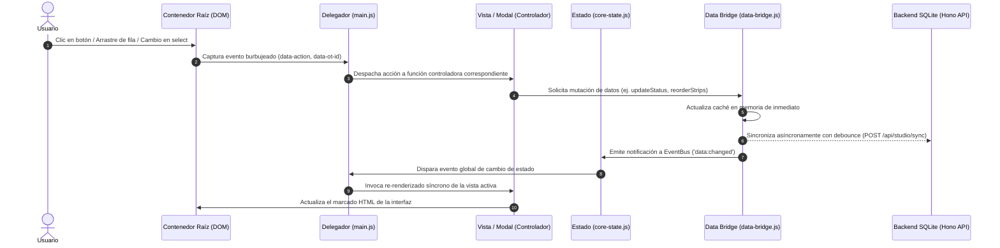
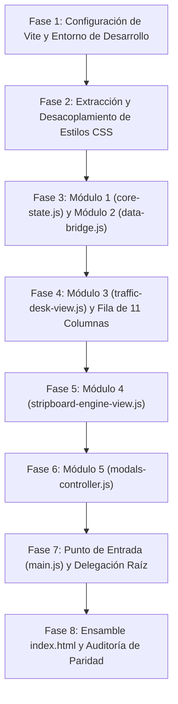

# Especificación Técnica: Refactorización Modular de Trafikeitor

> **Documento de Arquitectura y Plan de Refactorización**  
> **Estado**: Borrador técnico validado (Aprobación requerida antes de ejecución)  
> **Archivo de Referencia**: [`mesa_de_tr_fico_sobres_ot v1.1.html`](file:///Users/elmarcante/Desktop/El%20Marcante%20Tr%C3%A1fico/mesa_de_tr_fico_sobres_ot%20v1.1.html) (6.750 líneas)  
> **Documento Base del Sistema**: [`PLAN_MAESTRO.md`](file:///Users/elmarcante/Desktop/El%20Marcante%20Tr%C3%A1fico/docs/PLAN_MAESTRO.md)  
> **Servidor Backend Asociado**: [`src/server/index.ts`](file:///Users/elmarcante/Desktop/El%20Marcante%20Tr%C3%A1fico/src/server/index.ts) (Hono + SQLite + Better Auth)  

---

## 1. Declaración del Problema (Problem Statement)

El prototipo funcional [`mesa_de_tr_fico_sobres_ot v1.1.html`](file:///Users/elmarcante/Desktop/El%20Marcante%20Tr%C3%A1fico/mesa_de_tr_fico_sobres_ot%20v1.1.html) resuelve al 100% la experiencia operativa del estudio (gestión de Órdenes de Trabajo, Stripboard de producción en 4 vistas, visor de suites de diseño y mesa de tráfico). Sin embargo, concentra **6.750 líneas** en un único archivo HTML que mezcla estilos en línea, marcado de vistas y más de 5.200 líneas de JavaScript monolítico.

Esta estructura genera cuatro cuellos de botella técnicos críticos:
1. **Riesgo de regresión por colisión**: Cualquier edición en la tabla unificada o en los modales puede corromper variables globales compartidas (`dragState`, `orders`, `currentTableSort`), rompiendo funcionalidades no relacionadas.
2. **Desconexión con el Backend de Producción**: La persistencia del monolito opera mediante lecturas y escrituras directas a `localStorage`, ignorando el backend en TypeScript/Hono con base de datos SQLite WAL ([`trafico.db`](file:///Users/elmarcante/Desktop/El%20Marcante%20Tr%C3%A1fico/trafico.db)) ya implementado en [`src/server/index.ts`](file:///Users/elmarcante/Desktop/El%20Marcante%20Tr%C3%A1fico/src/server/index.ts).
3. **Inviabilidad de Pruebas Automatizadas**: Es inviable ejecutar pruebas unitarias o de integración sobre funciones aisladas (cálculo de franjas horarias, reordenamiento de tiras, catálogos) al estar acopladas directamente a selectores del DOM.
4. **Barrera para la Colaboración**: Múltiples agentes o desarrolladores no pueden trabajar en paralelo en vistas específicas (ej. Stripboard vs. Mesa de Tráfico) sin generar conflictos de fusión (*merge conflicts*) insolubles.

---

## 2. Objetivos y Fuera de Alcance (Goals & Non-Goals)

### 2.1. Objetivos (Goals)
1. **Desacoplamiento en 5 Módulos de Dominio**: Consolidar la lógica del cliente en exactamente 5 módulos de JavaScript cohesivos y mantenibles dentro de `src/client/`, eliminando la dispersión de archivos y las dependencias circulares.
2. **Data Bridge Unificado hacia SQLite/Hono**: Implementar `data-bridge.js` como cliente desacoplado que consuma los endpoints REST del servidor (`/api/studio/bootstrap`, `/api/studio/sync`, `/api/studio/upload`), manteniendo una caché síncrona en memoria y fallback transparente a `localStorage` si el servidor no responde.
3. **Servidor de Desarrollo con Vite (Puerto 5173)**: Integrar Vite para desarrollo frontend en el puerto `5173`, resolviendo de forma nativa las restricciones de CORS que impiden ejecutar módulos ES sobre el protocolo `file:///`.
4. **Delegación de Eventos (`data-action`)**: Reemplazar todos los atributos inline (`onclick`, `ondrop`, `ondragstart`) y el puente global en `window` por un despachador centralizado de eventos basado en delegación en el contenedor raíz.
5. **Flujo Unidireccional Estricto**: Garantizar que los módulos de estado y datos no tengan acceso ni referencias al DOM, comunicándose con las vistas exclusivamente a través de eventos personalizados (`CustomEvent`).
6. **Paridad Funcional y Visual 100%**: Preservar con exactitud matemática el orden de las 11 columnas de la fila unificada, el recorte de clips en Gantt, los 8 modales y la estética oscura tipo macOS.

### 2.2. Fuera de Alcance (Non-Goals)
1. **No Frameworks SPA**: No se introducirán frameworks reactivos (React, Vue, Svelte, Angular). La solución mantendrá JavaScript Vanilla nativo con manipulación eficiente del DOM.
2. **Sin Modificaciones al Esquema de Base de Datos**: No se alterarán las tablas existentes en Drizzle ORM / SQLite ([`src/server/db/schema.ts`](file:///Users/elmarcante/Desktop/El%20Marcante%20Tr%C3%A1fico/src/server/db/)) en este sprint.
3. **Sin Rediseño Visual**: No se alterará la paleta de colores, tipografías ni componentes visuales aprobados en `v1.1.html`.
4. **Sin Cambios de Rutas REST**: No se crearán endpoints adicionales en Hono si los existentes en [`src/server/index.ts`](file:///Users/elmarcante/Desktop/El%20Marcante%20Tr%C3%A1fico/src/server/index.ts) cubren la funcionalidad requerida.

---

## 3. Arquitectura Modular Propuesta (5 Módulos de Dominio)

La estructura del frontend se organizará dentro del árbol de trabajo en `src/client/`, integrándose con la configuración de Vite en el puerto `5173`:

```text
El Marcante Tráfico/
├── index.html                               # Marcado HTML semántico (sin scripts ni CSS inline)
├── vite.config.js                           # Configuración de Vite (puerto 5173, proxy /api hacia 3000)
├── package.json                             # Scripts de ejecución (dev:client, dev:server, build)
└── src/
    ├── client/
    │   ├── main.js                          # Punto de entrada: arranque, hidratación y delegación raíz
    │   ├── core-state.js                    # MÓDULO 1: Estado mutable central, constantes y EventBus
    │   ├── data-bridge.js                   # MÓDULO 2: Cliente REST SQLite/Hono + caché + fallback local
    │   ├── traffic-desk-view.js             # MÓDULO 3: Mesa de OTs, árbol Master Bin y fila de 11 columnas
    │   ├── stripboard-engine-view.js        # MÓDULO 4: Stripboard (Día, Semana, Gantt, Mes, Pool)
    │   ├── modals-controller.js             # MÓDULO 5: Controlador unificado de 8 modales y visor multimedia
    │   └── styles/
    │       ├── main.css                     # Scrollbars macOS, estilos de estampilla retro e indicadores
    │       └── print.css                    # Reglas de impresión para el Stripboard (@media print)
    └── server/
        ├── index.ts                         # Servidor Hono activo (puerto 3000, CORS hacia 5173)
        └── ...
```

---

### Detalle de los 5 Módulos de Dominio

#### Módulo 1: `core-state.js` (Estado Central, Constantes y EventBus)
* **Responsabilidad**: Contenedor único de estado en memoria y bus de mensajería desacoplado.
* **Patrón de Estado**: Para evitar errores de reasignación sobre live bindings inmutables de ES6 (`TypeError: Assignment to constant variable`), exporta una referencia constante con propiedades mutables:
  ```javascript
  export const state = {
    currentMainView: 'desk',             // 'desk' | 'stripboard'
    currentDeskMode: 'list',             // 'grid' | 'list'
    currentStripboardSubView: 'day',     // 'day' | 'week' | 'gantt' | 'month'
    currentStripboardDate: '',           // 'YYYY-MM-DD'
    selectedTreeFilter: { type: 'all', client: null, brand: null },
    currentTableSort: { field: 'none', dir: 'asc' },
    currentTableGroup: 'none',           // 'none' | 'client' | 'status' | 'responsible' | 'department'
    collapsedGroupKeys: new Set(),
    activeOtId: null,
    activeOtTab: 'route',
    dragState: {
      isDragging: false,
      sourceType: null,                  // 'table-row' | 'strip' | 'pool-ot'
      otId: null,
      sourceContext: null,
      sourceDate: null,
      dropTargetOtId: null,
      dropPosition: null,                // 'before' | 'after'
    }
  };
  ```
* **EventBus Nativo**: Instancia interna de `EventTarget` con métodos exportados:
  `on(event, handler)`, `off(event, handler)`, `emit(event, detail)`.
* **Funciones de Control Incluidas**:
  - `resetDragState()`: Limpia el estado de arrastre y reasigna los punteros a valores nulos.
  - `pauseRowDrag(el)` / `resumeRowDrag(el)`: Pausa y reanuda el atributo `draggable` durante la interacción con campos editables en la fila.
  - `clearStripDropIndicators()`: Remueve clases CSS (`drop-before`, `drop-after`, `dragging`) de todas las filas y tiras del DOM.

#### Módulo 2: `data-bridge.js` (Adaptador REST SQLite/Hono + Caché Síncrona + Fallback)
* **Responsabilidad**: Única fuente de verdad de datos en el cliente. Realiza la mediación entre la memoria síncrona que leen las vistas y la persistencia asíncrona del servidor Hono.
* **Cero Acceso al DOM**: Prohibido el uso de `document`, `window` o llamadas a funciones de renderizado dentro de este módulo.
* **Caché en Memoria**: Mantiene en memoria las colecciones activas: `ordersCache`, `clientsCache`, `statusesCache`, `stripboardCache`, `responsiblesCache`, `departmentsCache`.
* **Mecanismo de Hidratación y Guardado**:
  1. `bootstrap()`: Consulta `/api/studio/bootstrap`. Si responde exitosamente, puebla la caché en memoria y actualiza una copia de seguridad en `localStorage`. Si el servidor no responde o está desconectado, hidrata la memoria desde `localStorage`. Emite el evento `data:ready`.
  2. `scheduleSync()`: Implementa un debounce de 250 ms que envía las colecciones mutadas hacia `/api/studio/sync` mediante `POST` con credenciales de sesión. Si la petición falla, persiste la mutación en `localStorage` y encola la sincronización para el próximo intento.
* **Métodos Síncronos para Vistas**:
  - `getOrders()`, `getOrderById(id)`, `saveOrders(orders)`
  - `getClients()`, `saveClients(clients)`
  - `getStatuses()`, `saveStatuses(statuses)`, `getStatusBadgeClass(status)`
  - `getResponsibles()`, `addResponsible(name)`
  - `getDepartments()`, `addDepartment(name)`
  - `getDayStrips(dateStr)`, `saveDayStrips(dateStr, strips)`
* **Subida Física de Archivos**:
  - `uploadOtFiles(otId, files)`: Envía peticiones `multipart/form-data` hacia `/api/studio/upload` y anexa los ítems retornados en `mediaFiles` de la OT correspondiente.

#### Módulo 3: `traffic-desk-view.js` (Mesa de Tráfico y Fila Unificada de 11 Columnas)
* **Responsabilidad**: Renderizado y orquestación visual de la Mesa de OTs.
* **Componente de Fila Unificada (11 Columnas Estrictas)**:
  `renderUnifiedOtRow(ot, activeRoute, viewContext)` renderiza la estructura HTML de la fila con los atributos semánticos para delegación de eventos (`data-action="row-click"`, `data-ot-id="..."`, `data-action="inline-date"`, `data-action="inline-status"`, etc.).
  - Mantiene intacta la secuencia de izquierda a derecha:
    1. `No. OT` (con grip icon `⋮⋮` para arrastre)
    2. `Cliente`
    3. `Marca/Producto`
    4. `Medio`
    5. `Referencia`
    6. `Descripción`
    7. `Entrada` (Sincronizada con la fecha de entrada de la ruta activa)
    8. `Entrega` (Sincronizada con la fecha de entrega de la ruta activa)
    9. `Estado` (Selector con catálogo maestro)
    10. `Responsable` (Selector con catálogo maestro)
    11. `Notas` (Sincronizadas con la ruta activa)
* **Agrupación y Ordenamiento**:
  - `renderUnifiedTableRows(ordersList, viewContext)`: Genera las cabeceras de categoría colapsables (`category-row`) cuando `state.currentTableGroup !== 'none'` y ordena según `state.currentTableSort`.
* **Árbol Master Bin y Cuadrícula**:
  - `renderBinTree()`: Renderiza clientes, marcas y contadores badge del panel lateral.
  - `renderTrafficDesk()`: Filtra las órdenes según el árbol bin, la caja de búsqueda y el selector de estado, desplegando la vista de lista o de cuadrícula (`envelopes-grid`).

#### Módulo 4: `stripboard-engine-view.js` (Motor de Stripboard y Vistas Operativas)
* **Responsabilidad**: Orquestación de las 4 modalidades del Stripboard y del Media/OT Pool.
* **Vistas Implementadas**:
  1. **Día (`stripboard-day`)**: Utiliza `renderUnifiedTableRows` en modo `'stripboard'` con soporte de ordenamiento manual y arrastre de filas.
  2. **Semana (`stripboard-week`)**: Cuadrícula de 6 columnas (Lunes a Sábado) que distribuye las tiras y permite arrastrarlas entre días mediante delegación `data-action="week-day-drop"`.
  3. **Gantt (`stripboard-gantt`)**: Diagrama temporal por pistas departamentales con recorte interactivo de clips.
     - `startGanttClipTrim(event, dateStr, stripIdx, edge)`: Captura los eventos `mousemove` y `mouseup` sobre el documento, actualizando la duración visual mediante un HUD flotante sin mutar el store hasta que se suelta el clic.
  4. **Mes (`stripboard-month`)**: Calendario mensual con compromisos de entrega y distribución por celdas.
  5. **Pool de Pendientes (`stripboard-pool`)**: Panel lateral con filtros (`all`, `unscheduled`, `scheduled`) y tiras listas para ser arrastradas al tablero del día.
* **Ciclo de Vida y Navegación Temporal**:
  - `initStripboard()`, `setStripboardViewMode(mode)`, `selectStripboardDate(dateStr)`, `changeStripboardDay(offset)`.

#### Módulo 5: `modals-controller.js` (Controlador de Modales y Visor Multimedia)
* **Responsabilidad**: Gestión integral de los 8 modales del sistema, sincronización de formularios y visor multimedia.
* **Modales Controlados**:
  1. `envelope-modal`: Detalle del Sobre OT (Header de 8 campos, Hoja de Ruta de 7 campos por línea, Media Pool, Especificaciones, Testigo Stripboard y Sellos).
  2. `media-preview-modal`: Visor en pantalla completa con soporte para imágenes, código, markdown, suites nativas de diseño (`.afdesign`, `.ai`, `.psd`, etc.) y previsualizador tipográfico interactivo con cambio dinámico de tamaño y texto de prueba.
  3. `new-ot-modal`: Formulario de alta con autocompletado reactivo de marcas según el cliente seleccionado.
  4. `custom-task-modal`: Creación y edición de turnos y tareas libres en el Stripboard.
  5. `status-manager-modal`: Creación, edición, cambio de color y eliminación de estados (`deleteStatus`, `renameStatus`, `updateStatusColor`).
  6. `client-modal` y `brand-modal`: Gestión de entidades de clientes y marcas en el árbol.
  7. `stamp-modal`: Selector y estampador de sellos de tinta retro.
* **Manejo de Teclado**:
  - Listener global de tecla `Escape` (cierre jerárquico de modales) y flechas `ArrowLeft`/`ArrowRight` para navegar ítems en el visor multimedia.

---

## 4. Alternativas Evaluadas (The Alternatives Rule)

En cumplimiento estricto del estándar de especificación técnica, se evaluaron cuatro enfoques arquitectónicos alternativos, detallando las razones técnicas para su rechazo:

| Criterio / Arquitectura | Opción A: Módulos ES Nativos sobre `file:///` (Plan Rechazado) | Opción B: Framework SPA Completo (React / Vue / Svelte) | Opción C: Web Components (Custom Elements) | Opción D: Vite + Vanilla JS Modular (Arquitectura Aprobada) |
| :--- | :--- | :--- | :--- | :--- |
| **Compatibilidad Local** | ❌ **Falla (Bloqueo CORS)**. Los navegadores impiden cargar módulos bajo `file:///`. | ⚠️ Requiere servidor local y build continuo (`npm run dev`). | ⚠️ Requiere servidor local por importación de módulos o plantillas. | ✅ **Óptima**. Vite en puerto 5173 sirve módulos sin bloqueo y con HMR instantáneo. |
| **Carga de Red (Waterfall)** | ❌ **Crítica**. Cascada de más de 25 peticiones HTTP secuenciales. | ✅ Excelente (empaquetado en 1 o 2 chunks). | ⚠️ Media (múltiples definiciones de componentes). | ✅ **Excelente**. Vite resuelve dependencias y empaqueta en bundle único para producción. |
| **Riesgo para UI DaVinci** | ⚠️ Medio (acoplamiento frágil a `window`). | ❌ **Alto**. Riesgo de romper el trimming temporal en Gantt y drag & drop de tablas por reconciliación virtual del DOM. | ⚠️ Alto. Shadow DOM rompe el paso de utilidades Tailwind CSS. | ✅ **Cero**. Preserva la manipulación directa y precisa del DOM de la app aprobada. |
| **Complejidad y Peso** | ⚠️ Baja en archivos, pero alta en parches (`window`). | ❌ **Alta**. Añade dependencias pesadas, compiladores JSX y dependencias de node_modules. | ⚠️ Media. Complejidad en ciclo de vida y slots. | ✅ **Mínima**. 100% Vanilla JS nativo sin capas de abstracción innecesarias. |
| **Alineación con Backend** | ❌ Nula (persistía en `localStorage` aislado). | ⚠️ Requiere reescribir clientes de API completos. | ⚠️ Requiere adaptación de eventos. | ✅ **Total**. Se conecta directamente con [`src/server/index.ts`](file:///Users/elmarcante/Desktop/El%20Marcante%20Tr%C3%A1fico/src/server/index.ts) que ya tiene CORS para 5173. |

### Razón de Rechazo de las Opciones Alternativas:
1. **Rechazo de Opción A (ES Modules nativos sobre `file:///`)**:
   Inviable técnicamente. Los navegadores modernos bloquean por política de seguridad CORS las solicitudes de scripts de tipo módulo originadas desde `file:///`. No existe portabilidad real sin servidor local.
2. **Rechazo de Opción B (Frameworks SPA - React/Vue/Svelte)**:
   Viola el principio de simplicidad y YAGNI. La lógica del Stripboard (arrastre entre 6 columnas de días, recorte de clips en Gantt con seguimiento de píxeles en tiempo real y cálculo de slots temporales) ya está desarrollada y probada en Vanilla JS. Reescribirla sobre el Virtual DOM de React añade sobrecarga computacional y riesgos severos de desfase en animaciones e interacciones de arrastre.
3. **Rechazo de Opción C (Web Components / Custom Elements)**:
   El encapsulamiento mediante Shadow DOM aísla los componentes de las clases globales generadas por Tailwind CSS, obligando a duplicar estilos o adoptar soluciones complejas de CSS-in-JS.

---

## 5. Diagrama de Flujo de Datos y Secuencia Unidireccional

Para erradicar dependencias circulares y garantizar un flujo de control predecible, el sistema adopta un **flujo unidireccional estricto**:



### Reglas Inquebrantables de Dependencias:
1. **`core-state.js`** y **`data-bridge.js`** tienen **PROHIBIDO** importar módulos de vista (`traffic-desk-view.js`, `stripboard-engine-view.js`, `modals-controller.js`) o hacer llamadas al DOM.
2. Las vistas leen datos de forma **síncrona** desde `data-bridge.js` y delegan las mutaciones al mismo.
3. Las vistas se suscriben a los eventos emitidos por el EventBus de `core-state.js` para refrescar sus contenedores de forma reactiva.

---

## 6. Sistema de Delegación de Eventos (`data-action`)

Se elimina totalmente el patrón de inyectar métodos en `window.*`. En su lugar, `src/client/main.js` adjunta un único listener por tipo de evento en el contenedor principal (`#app-root` o `document.body`):

```javascript
// Ejemplo de arquitectura de delegación en main.js
document.addEventListener('click', (event) => {
  const actionTarget = event.target.closest('[data-action]');
  if (!actionTarget) return;

  const action = actionTarget.dataset.action;
  const otId = actionTarget.dataset.otId;
  const dateStr = actionTarget.dataset.date;

  switch (action) {
    case 'open-envelope':
      openEnvelopeModal(otId);
      break;
    case 'switch-main-view':
      switchMainView(actionTarget.dataset.view);
      break;
    case 'set-desk-view':
      setMainDeskView(actionTarget.dataset.mode);
      break;
    case 'open-new-ot':
      openNewOtModal();
      break;
    case 'add-route-row':
      addNewRouteRow();
      break;
    case 'delete-route-row':
      deleteRouteRow(parseInt(actionTarget.dataset.index, 10));
      break;
    // ... mapeo exhaustivo de todas las acciones
  }
});
```

### Atributos Semánticos Estándar:
* `data-action`: Nombre de la operación (`open-envelope`, `toggle-group`, `change-status`, `drag-handle`, `close-modal`).
* `data-ot-id`: Identificador alfanumérico único de la orden (`OT-26-001`).
* `data-index`: Índice numérico de fila en hoja de ruta o tira.
* `data-field`: Nombre del campo mutado (`status`, `responsible`, `inDate`, `outDate`, `notes`).

---

## 7. Mapeo Exhaustivo de Funciones Existentes (100% de Cobertura)

Se distribuyen la totalidad de las 104 funciones y variables globales del código original de `mesa_de_tr_fico_sobres_ot v1.1.html` dentro de los 5 módulos consolidados:

| Módulo de Destino | Funciones y Variables Asignadas |
| :--- | :--- |
| **`core-state.js`** | `state` (objeto mutable global), `STORAGE_KEY`, `CLIENTS_STORAGE_KEY`, `STATUSES_STORAGE_KEY`, `STRIPBOARD_STORAGE_KEY`, `SUITE_DEFS`, `resetDragState()`, `pauseRowDrag(el)`, `resumeRowDrag(el)`, `clearStripDropIndicators()`, `on(event, handler)`, `off(event, handler)`, `emit(event, detail)`. |
| **`data-bridge.js`** | `bootstrap()`, `scheduleSync()`, `uploadOtFiles(otId, files)`, `getOrders()`, `getOrderById(id)`, `saveOrders(orders)`, `getActiveRoute(ot)`, `getClients()`, `saveClients(clients)`, `getStatuses()`, `saveStatuses(statuses)`, `getStatusBadgeClass(status)`, `getResponsibles()`, `addResponsible(name)`, `getDepartments()`, `addDepartment(name)`, `getDayStrips(dateStr)`, `saveDayStrips(dateStr, strips)`, `getAllStripboardStorage()`, `formatDateKeyLocal(date)`, `deleteStatus(id)`, `renameStatus(id, newName)`, `updateStatusColor(id, color)`. |
| **`traffic-desk-view.js`** | `renderTrafficDesk()`, `renderBinTree()`, `selectTreeFilter(type, client, brand)`, `setMainDeskView(mode)`, `renderUnifiedOtRow(ot, activeRoute, viewContext)`, `renderUnifiedTableRows(ordersList, viewContext)`, `sortOrdersList(list)`, `setTableSort(field)`, `toggleTableSortDirection()`, `setTableGroup(groupField)`, `toggleGroupCollapse(groupKey)`, `syncSortAndGroupControls()`, `handleTableRowClick(event, otId)`, `handleTableOtDateChange(otId, field, value)`, `handleTableOtStatusChange(otId, val)`, `handleTableOtResponsibleChange(otId, val)`, `handleTableOtNotesChange(otId, val)`, `handleUnifiedRowDragStart(e, otId, context)`, `handleUnifiedRowDragOver(e, targetOtId, context)`, `handleUnifiedRowDragLeave(e)`, `handleUnifiedRowDrop(e, targetOtId, context)`, `handleUnifiedRowDragEnd(e)`, `handleCategoryRowDragOver(e)`, `handleCategoryRowDragLeave(e)`, `handleCategoryRowDrop(e, groupKey, context)`, `toggleSidebar()`. |
| **`stripboard-engine-view.js`** | `initStripboard()`, `renderStripboard()`, `renderStripboardWeekView()`, `renderStripboardGanttView()`, `renderStripboardMonthView()`, `renderStripboardPendingPool()`, `setStripboardPoolFilter(mode)`, `setStripboardViewMode(mode)`, `selectStripboardDate(dateStr)`, `changeStripboardDay(offset)`, `setStripboardToToday()`, `handleStripCardClick(e, otId, idx, date)`, `handleStripDragStart(e, idx, date)`, `handleStripDragOver(e, idx)`, `handleStripDragLeave(e)`, `handleStripDrop(e, targetIdx, date)`, `handleStripDragEnd(e)`, `handlePoolOtDragStart(e, otId)`, `handlePoolOtDragEnd(e)`, `moveStrip(index, dir)`, `removeStrip(index, date)`, `updateStripField(index, field, val, date)`, `cycleStripStatusOnDate(date, index)`, `autoPopulatePendingOts()`, `clearTodayStripboard()`, `printStripboard()`, `startGanttClipTrim(e, date, idx, edge)`, `shiftStripTimeSlot(date, idx, deltaMins)`, `parseTimeSlotToMinutes(slot)`, `minutesToHHMM(mins)`, `classifyDepartmentTrack(assignee)`, `extractCommitmentsByDate()`, `getWeekMondayToSaturday(refDate)`. |
| **`modals-controller.js`** | `openEnvelopeModal(otId)`, `closeEnvelopeModal()`, `switchOtTab(tab)`, `renderRouteSheetRows(routes)`, `addNewRouteRow()`, `updateRouteCell(index, field, val)`, `updateRouteDateCell(index, field, isoVal)`, `handleRouteDeptChange(index, field, val)`, `handleRouteSignChange(index, val)`, `toggleRouteDone(index)`, `deleteRouteRow(index)`, `stampCurrentTime(index, field)`, `renderModalStripboardWitness(otId)`, `jumpFromModalToStripboardDate(date)`, `removeStripFromModalWitness(date, idx)`, `scheduleActiveOtFromModal()`, `updateActiveOtField(field, val)`, `deleteActiveOt()`, `openNewOtModal()`, `closeNewOtModal()`, `handleCreateOt(e)`, `syncNewOtBrandSuggestions()`, `openCustomTaskModal(index, date)`, `closeCustomTaskModal()`, `saveCustomTaskModal(e)`, `deleteCustomTaskFromModal()`, `setCustomTaskAssignee(name)`, `promptNewResponsible()`, `openStatusManagerModal()`, `closeStatusManagerModal()`, `renderStatusManagerList()`, `handleCreateStatus(e)`, `openClientModal(id)`, `closeClientModal()`, `handleSaveClient(e)`, `deleteClient(id)`, `openBrandModal(client, brand)`, `closeBrandModal()`, `handleSaveBrand(e)`, `deleteBrand(client, brand)`, `openStampModal(index)`, `closeStampModal()`, `applyStamp(text)`, `clearCurrentStamp()`, `openMediaPreviewModal(index)`, `closeMediaPreviewModal()`, `stepSelectedMediaItem(delta)`, `renderMediaPreviewModalBody()`, `buildMediaViewerHtml(file)`, `renderInlineViewer()`, `setInlineCodeTab(mode)`, `setInlineMarkdownTab(mode)`, `setInlineFontSize(size, fileId)`, `setInteractiveFontPreset(text)`, `copyMediaCodeText(text, btn)`. |
| **`main.js`** | Inicialización del DOM (`DOMContentLoaded`), orquestador de refresco general `refreshAllViews()`, listeners de teclado (`Escape`, flechas), vinculación de delegación de eventos raíz y llamada inicial a `bootstrap()` de `data-bridge.js`. |

---

## 8. Fases de Ejecución Paso a Paso



### Fase 1: Configuración de Vite y Entorno de Desarrollo
1. Actualizar `package.json` para incorporar `vite` como dependencia de desarrollo e incluir los scripts:
   - `"dev:client": "vite --port 5173"`
   - `"dev": "concurrently \"npm run dev:server\" \"npm run dev:client\""`
2. Crear `vite.config.js` configurando el servidor en el puerto `5173` y proxy de rutas `/api` hacia `http://localhost:3000`.
3. Crear el archivo `index.html` inicial apuntando a `<script type="module" src="/src/client/main.js"></script>`.

### Fase 2: Extracción y Desacoplamiento de Estilos CSS
1. Crear `src/client/styles/main.css`:
   - Configuración de scrollbars estilo macOS dark.
   - Clases de efecto de estampilla retro (`.ink-stamp-box`).
   - Indicadores de drag & drop (`.stripboard-row`, `.drop-before`, `.drop-after`, `.dragging`).
   - Reseteo de indicadores nativos de selección de fecha.
2. Crear `src/client/styles/print.css` con las reglas de impresión para el Stripboard.
3. Importar los estilos directamente desde `index.html` o `main.js`.

### Fase 3: Núcleo de Estado y Adaptador de Datos (`core-state.js` & `data-bridge.js`)
1. Implementar `src/client/core-state.js` con el objeto `state` mutable, constantes maestras y EventBus nativo.
2. Implementar `src/client/data-bridge.js`:
   - Lógica de conexión con `/api/studio/bootstrap` y `/api/studio/sync`.
   - Caché síncrona en memoria para lectura de vistas.
   - Respaldo y fallback automático a `localStorage`.
   - Soporte de subida multipart a `/api/studio/upload`.
3. Ejecutar pruebas unitarias de Node.js validando la hidratación, operaciones CRUD en memoria y emisión de eventos.

### Fase 4: Mesa de Tráfico y Fila Unificada de 11 Columnas (`traffic-desk-view.js`)
1. Extraer la lógica de renderizado de la tabla unificada a `src/client/traffic-desk-view.js`.
2. Verificar que `renderUnifiedOtRow` genere exactamente las 11 columnas con sus atributos `data-action`.
3. Conectar el ordenamiento y agrupación colapsable con `state.currentTableSort` y `state.currentTableGroup`.
4. Implementar los manejadores de arrastre y soltado de filas y categorías dentro del módulo.

### Fase 5: Motor de Stripboard Operativo (`stripboard-engine-view.js`)
1. Implementar `src/client/stripboard-engine-view.js` con soporte para Día, Semana, Gantt, Mes y Pool.
2. Migrar la lógica de recorte temporal interactivo de DaVinci (`startGanttClipTrim`) con HUD flotante y límites de franjas horarias.
3. Conectar las operaciones de tiras con `saveDayStrips()` de `data-bridge.js`.

### Fase 6: Controlador de Modales y Visor Multimedia (`modals-controller.js`)
1. Implementar `src/client/modals-controller.js` consolidando los formularios de los 8 modales.
2. Migrar el visor multimedia en pantalla completa con soporte de tipografías dinámicas, código y suites de diseño.
3. Implementar el listener de teclado para `Escape` y navegación con flechas.

### Fase 7: Orquestación Raíz y Delegación de Eventos (`main.js`)
1. Crear `src/client/main.js`:
   - Conectar los listeners de delegación de eventos sobre `document.body` mapeando los atributos `data-action`.
   - Implementar `refreshAllViews()` coordinando el repintado de la vista activa (`traffic-desk` o `stripboard`).
   - Suscribir las vistas a los eventos `data:ready` y `data:changed` emitidos por `data-bridge.js`.
2. Invocar `dataBridge.bootstrap()` al cargar el DOM.

### Fase 8: Ensamble Final y Auditoría de Paridad
1. Limpiar `index.html` para contener exclusivamente el esqueleto semántico de la aplicación y modales sin código inline.
2. Ejecutar la aplicación en Vite (`http://localhost:5173`) y verificar la comunicación con el backend Hono en el puerto 3000.
3. Realizar auditoría visual interactiva comparando lado a lado contra `mesa_de_tr_fico_sobres_ot v1.1.html`.

---

## 9. Riesgos y Mitigaciones (Risks & Limits)

| Riesgo Técnico Identificado | Impacto | Estrategia de Mitigación Implementada |
| :--- | :---: | :--- |
| **Indisponibilidad del Servidor Backend** (desarrollo offline o caída de red). | Alto | `data-bridge.js` detecta fallos de conexión y conmuta automáticamente a lectura y escritura sobre `localStorage`, encolando las sincronizaciones para cuando el servidor se restablezca. |
| **Dependencias Circulares en Módulos ES** (tiendas invocando vistas que importan tiendas). | Crítico | Se prohibe el acceso al DOM desde `core-state.js` y `data-bridge.js`. La comunicación hacia las vistas se realiza exclusivamente a través del EventBus (`CustomEvent`). |
| **Condiciones de Carrera por Carga Diferida** (`<script type="module">`). | Medio | El contenedor de la aplicación permanece con opacidad reducida o indicador de carga hasta que `dataBridge.bootstrap()` finaliza y emite `data:ready`, momento en el cual se activan las interacciones. |
| **Propagación Errática de Eventos Delegados** (clics sobre elementos hijos de botones con `data-action`). | Bajo | Todos los despachadores de delegación utilizan `event.target.closest('[data-action]')`, garantizando la captura correcta del contenedor semántico sin importar el elemento hijo clickeado. |
| **Rendimiento al Renderizar Listas Grandes** (múltiples filas en Día o Mes). | Bajo | `traffic-desk-view.js` y `stripboard-engine-view.js` operan sobre fragmentos de documento en memoria (`DocumentFragment`) y realizan un único repintado masivo del contenedor DOM (`innerHTML`). |

---

## 10. Criterios de Aceptación y Control (Safety Gates)

La refactorización se considerará satisfactoria únicamente cuando cumpla los siguientes criterios medibles:

1. **Secuencia Exacta de 11 Columnas**: La tabla en Mesa de Tráfico y en Stripboard Día debe renderizar de izquierda a derecha la secuencia fija:  
   `1. No. OT` | `2. Cliente` | `3. Marca/Producto` | `4. Medio` | `5. Referencia` | `6. Descripción` | `7. Entrada` | `8. Entrega` | `9. Estado` | `10. Responsable` | `11. Notas`.
2. **Centralización de Catálogos**: La creación de un nuevo Estado o Responsable mediante la opción interactiva `+ Nuevo` debe guardarse a través de `data-bridge.js` y actualizar en tiempo real los selectores de la tabla, de la grilla y de los modales.
3. **Persistencia Dual en Stripboard Día**: Al arrastrar y soltar una fila en el Stripboard Día, la posición debe persistir de forma simultánea en la colección de tiras de la fecha activa y en la lista global de órdenes.
4. **Recorte Temporal Preciso en Gantt**: Los controles laterales de las tiras en la vista Gantt deben calcular y modificar las franjas horarias con intervalos de 15 minutos exactos y actualizar el indicador HUD en tiempo real sin desbordamientos de coordenadas.
5. **Cero Dependencia del Ámbito Global `window`**: La consola de herramientas de desarrollo debe permanecer libre de errores y no debe existir ninguna función de la aplicación anclada artificialmente a `window` para que la UI funcione.

---
*Fin de la Especificación Técnica Aprobada para Refactorización.*
