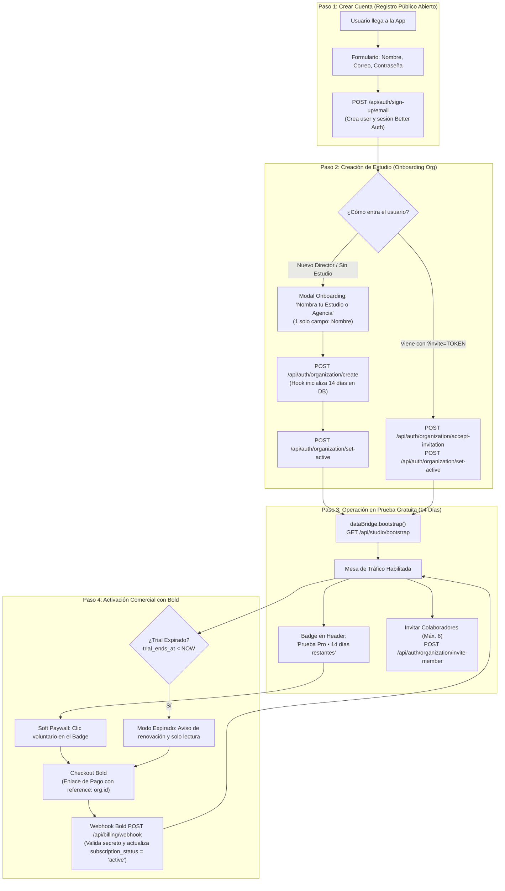

# Plan de Arquitectura e Implementación: SaaS PLG Onboarding en 4 Pasos (Better Auth Nativo + Bold)

Este documento define la arquitectura y el plan de implementación para el flujo comercial estándar **Product-Led Growth (PLG)** con modelo *Reverse Trial* (14 días de prueba gratuita sin tarjeta de crédito) para **Trafikeitor**, utilizando exclusivamente los estándares y plugins nativos de **Better Auth** (`organization`) y la pasarela de pagos **Bold**.

---

## 1. Visión y Principios Rectores

1. **Autoservicio Directo (Time-to-Value < 60 segundos):**  
   El usuario no requiere tarjeta de crédito, aprobación comercial ni llamadas de ventas para comenzar a operar. El registro es público y directo.
2. **Estándar Better Auth Nativo:**  
   Se descartan middlewares personalizados de intercepción de registro o asignación propietaria de inquilinos. Se utiliza estrictamente la API nativa de Better Auth:
   - `auth.api.signUpEmail` (`POST /api/auth/sign-up/email`)
   - `auth.api.createOrganization` (`POST /api/auth/organization/create`)
   - `auth.api.setActiveOrganization` (`POST /api/auth/organization/set-active`)
   - `auth.api.inviteMember` (`POST /api/auth/organization/invite-member`)
   - `auth.api.acceptInvitation` (`POST /api/auth/organization/accept-invitation`)
3. **Separación de Tenancy: Equipo Interno vs Clientes Externos:**  
   - **Equipo Interno (Staff de la Agencia):** Gestionado como miembros de la organización en Better Auth (`owner`, `member`), con límite configurado de hasta 6 cupos (1 titular + 5 colaboradores).
   - **Clientes Externos:** No se registran como miembros de la organización ni consumen cupos. Su acceso a revisiones y aprobaciones de piezas se realiza de forma desacoplada mediante enlaces seguros de tokens firmados (`shared_reviews` / `/api/public/review/:token`).
4. **Invarianza del Modelo de Datos de Mesa de Tráfico:**  
   La estructura canónica de 11 columnas (`OT`, `Ref`, `Disciplina`, `Cliente`, `Marca`, `Producto`, `Título`, `Medio`, `Estado`, `Responsable`, `Urgente`), la Hoja de Ruta (`De -> Para`), el Stripboard y el Media Pool permanecen sin alteraciones funcionales.

---

## 2. Flujo de Onboarding y Activación PLG en 4 Pasos



### Narrativa y Entregables por Paso:
- **Paso 1 (Crear Cuenta):** El usuario ingresa Nombre, Correo y Contraseña. Se crea la sesión sin barreras de entrada ni tarjeta de crédito.
- **Paso 2 (Nombra tu Estudio):** Si el usuario no pertenece a ninguna organización ni porta invitación, un modal de un único campo le solicita el nombre de su agencia. El servidor genera el slug en segundo plano e inicializa la prueba de 14 días en SQLite.
- **Paso 3 (Uso Operativo Inmediato):** Se abre la Mesa de Tráfico con bootstrap completo. La barra superior muestra los días restantes. El director puede invitar hasta a 5 colaboradores de su equipo.
- **Paso 4 (Activación con Bold):** Antes o al vencer los 14 días, el usuario puede activar su plan mediante la pasarela **Bold**. Al confirmarse la transacción, el webhook de Bold reactiva la organización automáticamente.

---

## 3. Matriz de Control de Acceso y Redirección (Front-Controller)

Al inicializar la aplicación (`main.js` / `initializeApp()`), el sistema evalúa dos compuertas secuenciales:

### Compuerta 1: Preflight (Sesión y Espacio)

| Orden | Estado del Usuario | Acción / Interfaz Mostrada | Endpoint / Operación |
| :---: | :--- | :--- | :--- |
| **1.1** | **Sin Sesión Activa** | Desplegar formulario `AuthGate` (Iniciar Sesión / Crear Cuenta). | `POST /api/auth/sign-in/email` o `/sign-up/email` |
| **1.2** | **Con Sesión + Viene con `?invite=TOKEN`** | Aceptar invitación del estudio anfitrión y entrar a su espacio. | `POST /api/auth/organization/accept-invitation`<br/>`POST /api/auth/organization/set-active` |
| **1.3** | **Con Sesión pero Sin Estudio (`activeOrganizationId === null`)** | Desplegar modal forzoso de Onboarding: *"Nombra tu Estudio"*. | `POST /api/auth/organization/create` |
| **1.4** | **Con Sesión y Estudio Activo** | Solicitar bootstrap de datos al servidor. | `dataBridge.bootstrap()` (`GET /api/studio/bootstrap`) |

### Compuerta 2: Post-Bootstrap (Estado de Prueba y Suscripción)

| Orden | Respuesta de Bootstrap | Acción / Interfaz Mostrada | Endpoint / Operación |
| :---: | :--- | :--- | :--- |
| **2.1** | **Suscripción Activa o Trial Vigente (`subscriptionStatus === 'active'` o `trialDaysLeft > 0`)** | Renderizar Mesa de Tráfico completa e hidratar `#header-trial-badge`. | Mesa de Tráfico operativa (`POST /api/studio/sync` habilitado). |
| **2.2** | **Trial Expirado sin Suscripción (`trialDaysLeft <= 0` y `subscriptionStatus !== 'active'`)** | Desplegar aviso de expiración y abrir `#subscription-paywall-modal`. | Modo solo lectura: `sync` bloqueado con 402; habilitada exportación de respaldo (`exportBackupData()`). |

---

## 4. Fases de Implementación

### Fase 1: Base de Datos, Tenancy y Hook de Persistencia de Trial
**Estado:** `[x] (Completada y Verificada)`

- [x] **`src/server/db/schema.ts`**:
  - Eliminar tabla obsoleta `studios` y columnas `studio_id` de las 8 tablas de dominio.
  - Incorporar columnas a `organizations`: `subscription_status` (`text`, default `'trialing'`), `trial_ends_at` (`integer mode timestamp`), `status` (`text`, default `'active'`).
- [x] **`src/server/auth.ts`**:
  - Configurar `role: { input: false }` para impedir mutaciones arbitrarias de privilegios.
  - Incorporar hook nativo para persistir obligatoriamente los 14 días al crear la organización:
    ```typescript
    databaseHooks: {
      organization: {
        create: {
          before: async (org) => ({
            data: {
              ...org,
              subscriptionStatus: 'trialing',
              trialEndsAt: new Date(Date.now() + 14 * 86400 * 1000),
              status: 'active',
            },
          }),
        },
      },
    }
    ```
- [x] **`src/server/index.ts`**:
  - Habilitar registro 100% público sin intercepciones 403.
  - Enriquecer `/api/studio/bootstrap` con métricas de prueba (`subscriptionStatus`, `trialEndsAt`, `trialDaysLeft`).

---

### Fase 2: Onboarding "Nombra tu Estudio" y Adaptador de Datos Client-Side
**Estado:** `[x] (Completada y Verificada)`
**Objetivo:** Capturar el evento de falta de organización, evitar fugas de datos locales demo y guiar al usuario a crear su agencia en un formulario de 1 solo campo.

- [x] **`[Modify] src/client/data-bridge.js`**:
  - En `bootstrap()`:
    - Interceptar respuestas `res.status === 403` con `{ error: 'no_organization' }`. Retener el objeto `user` de sesión y emitir `emit('auth:no-organization', { user })`. Evitar degradar silenciosamente a modo offline.
    - Sincronización limpia de caché: Si la respuesta del servidor es válida (`Array.isArray(data.orders)`), actualizar `ordersCache = data.orders` y `clientsCache = data.clients` incluso si la longitud es 0 (`[]`), eliminando datos demo locales de la memoria para que `scheduleSync()` no los suba a la nueva base de datos.
  - En `scheduleSync()`:
    - Interceptar respuestas `res.status === 402` o `trial_expired` y emitir `emit('billing:trial-expired')`.
- [x] **`[Modify] index.html`**:
  - Diseñar el modal `#onboarding-studio-modal` con estética macOS Dark:
    - Atributo: `data-blocking="true"` (no cerrable con clic exterior ni tecla `Escape`).
    - Título: *"Nombra tu Estudio o Agencia"*.
    - Subtítulo: *"Configura tu espacio para iniciar tus 14 días de prueba Pro sin costo."*
    - Formulario `#onboarding-studio-form` con **1 solo campo visible:**
      - Label: *"Nombre del Estudio o Agencia"*.
      - Input `#onboarding-studio-name` (Placeholder: `Ej. Central Constructora de Marcas`).
      - Input hidden `#onboarding-studio-slug` (auto-derivado en tiempo real).
    - Feedback de error `#onboarding-studio-error`.
    - Botón de envío `#onboarding-studio-submit-btn`: `Comenzar Prueba Gratuita (14 Días) →`.
- [x] **`[Modify] src/client/modals-controller.js`**:
  - Implementar funciones `openOnboardingStudioModal()` y `handleCreateStudioOnboarding(event)`:
    - Algoritmo de slug automático al escribir en `#onboarding-studio-name`:
      ```javascript
      const slug = name.toLowerCase().trim()
        .normalize('NFD').replace(/[\u0300-\u036f]/g, '')
        .replace(/[^a-z0-9]+/g, '-')
        .replace(/^-+|-+$/g, '');
      ```
    - En el submit: invocar `POST /api/auth/organization/create` enviando `{ name, slug }`.
    - Llamar a `POST /api/auth/organization/set-active` con el ID creado.
    - Ocultar el modal e invocar `dataBridge.bootstrap()`.
- [x] **`[Modify] src/client/main.js`**:
  - Suscribir el listener `dataBridge.on('auth:no-organization', () => openOnboardingStudioModal())`.
  - En el listener global de teclado `Escape`, validar `if (activeModal?.dataset.blocking === 'true') return;` para evitar el cierre accidental del onboarding.

---

### Fase 3: Indicador de Cabecera (Header Badge) y Modal de Pago Bold
**Estado:** `[x] (Completada y Verificada)`
**Objetivo:** Mostrar de forma permanente los días restantes de prueba y proveer el botón de checkout conectado a Bold.

- [x] **`[Modify] index.html`**:
  - En la barra de herramientas superior, integrar el componente interactivo `#header-trial-badge`:
    - Clase `.badge--trial-healthy` (`trialDaysLeft > 3`): `Prueba Pro: 12 días restantes`.
    - Clase `.badge--trial-warning` (`trialDaysLeft <= 3`): `Prueba Pro: 2 días restantes`.
    - Clase `.badge--active` (`subscriptionStatus === 'active'`): `Plan Pro Activo`.
  - Diseñar el modal `#subscription-paywall-modal` con estética DaVinci Resolve Dark:
    - Selector de cierre condicional (botón `X` visible en Soft Paywall, oculto en Hard Paywall).
    - Resumen del Plan Pro: Órdenes de trabajo ilimitadas, Media Pool, Stripboard en tiempo real y hasta 6 colaboradores de equipo.
    - Botón principal de checkout: `#paywall-bold-checkout-btn` (*"Activar Plan Pro con Bold"*).
    - Botón secundario para situaciones de expiración: `#paywall-export-backup-btn` (*"Descargar Respaldo de Mis Datos (JSON)"*).
- [x] **`[Modify] src/client/modals-controller.js`**:
  - Implementar `openSubscriptionPaywallModal(isBlocking = false)` y `closeSubscriptionPaywallModal()`:
    - Si `isBlocking === true`, establecer `data-blocking="true"` y ocultar el botón de cierre.
    - Manejar el clic en `#paywall-bold-checkout-btn`:
      - Abrir la URL de pago de Bold pasando la referencia de la organización:
        ```javascript
        const boldBaseUrl = window.BOLD_CHECKOUT_URL || 'https://checkout.bold.co/payment/LNK_TRAFIKEITOR_PRO';
        const checkoutUrl = `${boldBaseUrl}?reference=${encodeURIComponent(currentOrgId)}`;
        window.open(checkoutUrl, '_blank');
        ```
    - Manejar el clic en `#paywall-export-backup-btn` invocando `exportBackupData()`.
- [x] **`[Modify] src/client/main.js`**:
  - Al recibir los datos de `dataBridge.bootstrap()`, actualizar el texto y clases de `#header-trial-badge`.
  - Vincular el clic en `#header-trial-badge` para invocar `openSubscriptionPaywallModal(false)` (Soft Paywall voluntario).

---

### Fase 4: Modo Expirado y Webhook de Activación Comercial con Bold
**Estado:** `[x] (Completada y Verificada)`
**Objetivo:** Proteger la integridad del servicio al finalizar los 14 días y reactivar de inmediato tras el pago confirmado en Bold.

- [x] **`[Modify] src/server/index.ts`**:
  - Middleware de Control en `/api/studio/*`:
    - Validar: `trial_ends_at < NOW` y `subscription_status !== 'active'`.
    - Si la condición se cumple:
      - Permitir peticiones `GET` (lectura de estado y bootstrap para respaldos).
      - Rechazar peticiones de mutación `POST /api/studio/sync` con código `402 Payment Required`:
        ```json
        {
          "ok": false,
          "error": "trial_expired",
          "message": "Tu período de prueba de 14 días ha finalizado. Activa tu suscripción para continuar editando."
        }
        ```
  - Endpoint Webhook de Bold (`POST /api/billing/webhook`):
    - Validar secreto o firma enviada por Bold mediante variable de entorno `BOLD_WEBHOOK_SECRET`:
      ```typescript
      const secret = c.req.header('x-bold-signature') || c.req.header('x-webhook-secret');
      if (process.env.BOLD_WEBHOOK_SECRET && secret !== process.env.BOLD_WEBHOOK_SECRET) {
        return c.json({ ok: false, error: 'unauthorized' }, 401);
      }
      ```
    - Parsear el cuerpo de la notificación de Bold:
      - Verificar si el estado del pago es aprobado (`data.status === 'APPROVED'` o payload equivalente de Bold).
      - Extraer el identificador de la organización desde `reference` o `metadata.organizationId`.
      - Ejecutar actualización atómica en SQLite:
        ```sql
        UPDATE organizations 
        SET subscription_status = 'active', status = 'active' 
        WHERE id = ?;
        ```
      - Retornar `{ ok: true, received: true }`.
- [x] **`[Modify] src/client/main.js`**:
  - Suscribir el listener `dataBridge.on('billing:trial-expired', () => openSubscriptionPaywallModal(true))`.

---

### Fase 5: Invitación de Miembros de Equipo
**Estado:** `[x] (Completada y Verificada en el Repositorio)`

- [x] **`src/client/modals-controller.js`**:
  - `handleSendTeamInvite(event)` invoca `POST /api/auth/organization/invite-member` con `{ email, role: 'member' }`.
  - `handleCopyTeamInviteLink` genera y copia el enlace directo `?invite=${invitationId}` con 1 clic.
  - `handleCancelTeamInvite` cancela invitaciones pendientes vía Better Auth.
- [x] **`src/client/main.js`**:
  - Captura del parámetro `?invite=TOKEN` en la carga inicial y en el formulario de login.
  - Consumo automático de `accept-invitation` y `set-active` al autenticarse, entrando directo al estudio anfitrión sin pasar por onboarding.
- [x] **`index.html`**:
  - Markup del panel de gestión de equipo (`#user-modal-invite-box`, tabla de miembros e invitaciones).

---

## 5. Matriz Canónica de Roles y Alcances Operativos

| Rol en Organización | Ámbito de Gestión | Cupos Máximos | Mecanismo de Acceso |
| :--- | :--- | :--- | :--- |
| **Owner (Propietario / Director)** | Acceso administrativo total, gestión de equipo, suscripción y mesa de tráfico. | 1 por Estudio | Cuenta titular en Better Auth (`role = 'owner'`). |
| **Member (Colaborador)** | Tráfico, edición de OTs, Stripboard, Media Pool y Hoja de Ruta. | Hasta 5 adicionales (Total 6) | Invitación por Better Auth (`role = 'member'`). |
| **Cliente Externo** | Aprobación y visualización exclusiva de piezas y entregables asignados. | Ilimitados | Token de revisión pública sin registro (`shared_reviews` / `/api/public/review/:token`). |

---

## 6. Verificación Automatizada y Criterios de Aceptación

Para certificar la implementación de forma programática antes de cualquier despliegue, se ejecutará el script de pruebas de extremo a extremo:

```bash
npx tsx scripts/verify-plg-flow.ts
```

### Batería de Pruebas Automatizadas en el Script:

1. **Test 1: Registro Público Abierto y Compuerta de Onboarding:**
   - Crear un usuario con `auth.api.signUpEmail` -> Retorna `200 OK` y sesión activa.
   - Invocar `GET /api/studio/bootstrap` antes de crear organización -> Debe retornar `403 Forbidden` con `{ error: 'no_organization' }`.
2. **Test 2: Creación de Estudio y Persistencia de 14 Días:**
   - Enviar `POST /api/auth/organization/create` con `{ name, slug }`.
   - Consultar directamente SQLite: verificar que `trial_ends_at` sea una fecha válida (`Date.now() + 14 días`) y `subscription_status = 'trialing'`.
3. **Test 3: Bootstrap y Sincronización Limpia:**
   - Invocar `GET /api/studio/bootstrap` con la organización activa -> Retorna `trialDaysLeft: 14` y colecciones vacías.
   - Enviar `POST /api/studio/sync` con una OT -> Retorna `200 OK` y la persiste correctamente en base de datos.
4. **Test 4: Simulación de Expiración de Prueba:**
   - Modificar en SQLite `trial_ends_at = Date.now() - 3600000` (1 hora en el pasado).
   - Invocar `GET /api/studio/bootstrap` -> Retorna `trialDaysLeft: 0`.
   - Enviar `POST /api/studio/sync` -> Debe ser rechazado con `402 Payment Required` (`{ error: 'trial_expired' }`).
5. **Test 5: Webhook de Bold y Reactivación:**
   - Enviar `POST /api/billing/webhook` con encabezado secreto y payload simulado de Bold (`status: 'APPROVED'`, `reference: orgId`).
   - Consultar SQLite: verificar que `subscription_status` cambió a `'active'`.
   - Reintentar `POST /api/studio/sync` -> Debe retornar `200 OK` (desbloqueado).
