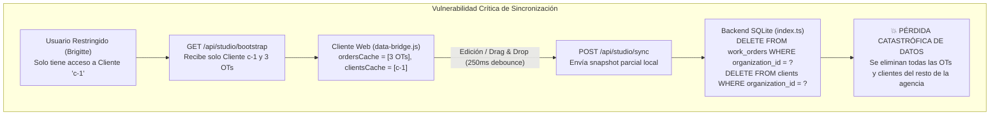
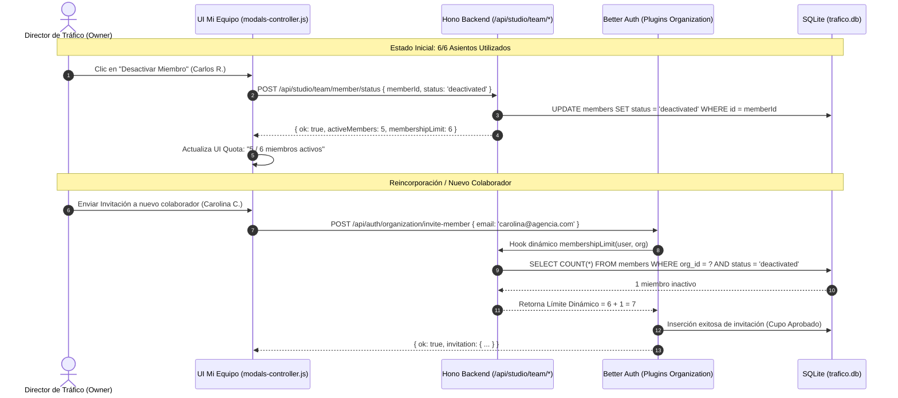

# Dictamen Consolidado de Auditoría Técnica y Arquitectura: Gestión de Equipo Colaborativo ("Mi Equipo")

**Documento Evaluado:** [`docs/PLAN_GESTION_EQUIPO_COLABORATIVO.md`](file:///Users/elmarcante/Desktop/El%20Marcante%20Tr%C3%A1fico/docs/PLAN_GESTION_EQUIPO_COLABORATIVO.md)  
**Fecha de Dictamen:** 2026-11-12  
**Código Base Auditado:** `/Users/elmarcante/Desktop/El Marcante Tráfico/src` y [`index.html`](file:///Users/elmarcante/Desktop/El%20Marcante%20Tr%C3%A1fico/index.html)  
**Protocolo:** `/egm-review` (Preset 1: Informe Consolidado Multidisciplinar de 7 Dimensiones)  
**Panel Auditor:**
- **Skeptical & Zoom-Out Architects** (`egm-zoom-out`): Simplicidad, alineación YAGNI, límites de diseño y prevención de callejones sin salida.
- **Naive Comprehension Reader** (`egm-comprehension`): Claridad conceptual sin conocimiento previo asumido, resolución de acrónimos y consistencia de contratos.
- **Structural Layout Validator** (`egm-structural`): Jerarquía de encabezados, simetría documental, validación de diagramas Mermaid y eliminación de sintaxis LaTeX errónea.
- **Technical Copy Editor** (`egm-style`): Precisión lingüística, rigor técnico, eliminación de glaseado publicitario y verificación factual.
- **Hostile Design Critic** (`egm-design`): Consistencia de estado, concurrencia, seguridad de tenancy, integridad transaccional y prevención de corrupción de datos.
- **Pragmatic Tech Lead** (`egm-implementation-readiness`): Ejecutabilidad de fases paso a paso, contratos HTTP (payloads/DTOs) y harness de pruebas.
- **Strict Compliance Officer** (`egm-codebase-details`): Ajuste exacto al código existente en `src/server`, `src/client` y `index.html`.

---

## 1. Resumen Ejecutivo y Veredicto Final

> [!CAUTION]
> **VEREDICTO DE AUDITORÍA: REPROBADO (REQUIERE REFACTORIZACIÓN ARQUITECTÓNICA PREVIA A LA IMPLEMENTACIÓN)**  
> La visión de dotar a Trafikeitor de un modelo de gobernanza para agencias y estudios inspirado en **Wrike** y **ClickUp** (trazabilidad histórica de firmas, desactivación de colaboradores sin borrado y protocolo de cero OTs huérfanas) es de alto valor estratégico. Sin embargo, el documento en su versión 1.0.0 **no puede ser ejecutado tal como está redactado**: contiene **2 Bloqueadores Críticos (uno con riesgo inminente de destrucción masiva de datos en SQLite)**, **7 Hallazgos Mayores** y **3 Observaciones Menores** que provocarían el colapso operativo del sistema en desarrollo y producción.

### Resumen de los Bloqueadores Críticos

```
┌────────────────────────────────────────────────────────────────────────────────────────┐
│                              LOS DOS BLOQUEADORES CRÍTICOS                             │
├────────────────────────────────────────────────────────────────────────────────────────┤
│ 1. PÉRDIDA CATASTRÓFICA DE DATOS EN /api/studio/sync POR FILTRADO ABAC (PILAR 3)        │
│    El backend actual ejecuta un reemplazo transaccional destructivo:                   │
│    DELETE FROM work_orders WHERE organization_id = ?                                   │
│    Si en bootstrap se entregan solo los clientes permitidos a un usuario restringido,  │
│    su navegador (data-bridge.js) sincronizará ese subconjunto parcial tras 250ms,      │
│    BORRANDO DE MANERA IRREVERSIBLE TODAS LAS ÓRDENES Y CLIENTES DEL RESTO DEL ESTUDIO. │
├────────────────────────────────────────────────────────────────────────────────────────┤
│ 2. MODELO DE CUOTAS BETTER AUTH ROTO (memberLimit vs status = 'deactivated')           │
│    Better Auth cuenta todas las filas en members (SELECT count(*) FROM members).       │
│    Desactivar lógicamente a un usuario no reduce el conteo en Better Auth; al llegar   │
│    al límite de 6 miembros, Better Auth RECHAZARÁ TODA NUEVA INVITACIÓN (403),        │
│    imposibilitando la liberación real de asientos anunciada en el Pilar 2.             │
└────────────────────────────────────────────────────────────────────────────────────────┘
```

---

## 2. Matriz Consolidada de Trazabilidad de Hallazgos

| ID | Dimensión Revisor | Severidad | Descripción del Hallazgo | Archivos Afectados | Acción de Remediación Obligatoria |
| :--- | :--- | :---: | :--- | :--- | :--- |
| **B-01** | Zoom-Out, Design, Readiness, Codebase | 🔴 **BLOCKER** | **Destrucción masiva de órdenes en `/api/studio/sync`:** El borrado global en SQLite (`DELETE FROM work_orders WHERE organization_id = ?`) destruye las órdenes de los clientes no asignados cuando un usuario restringido (Pilar 3) autoguarda. | [`src/server/index.ts#L417-L520`](file:///Users/elmarcante/Desktop/El%20Marcante%20Tr%C3%A1fico/src/server/index.ts#L417-L520), [`src/client/data-bridge.js#L500-L536`](file:///Users/elmarcante/Desktop/El%20Marcante%20Tr%C3%A1fico/src/client/data-bridge.js#L500-L536) | **Decisión Arquitectónica:** Retirar Pilar 3 (ABAC) del alcance de un solo estudio; orientar la separación estricta por NDAs hacia Multi-Workspace nativo de Better Auth (`setActiveOrganization`). Si se mantiene, transformar `/api/studio/sync` en upserts selectivos por entidad sin `DELETE` masivo. |
| **B-02** | Zoom-Out, Design, Readiness, Codebase | 🔴 **BLOCKER** | **Cupos de Better Auth bloqueados:** `membershipLimit: 6` en Better Auth cuenta filas totales en `members` (`SELECT count(*)`). Un usuario `status = 'deactivated'` no libera asiento ante Better Auth y bloquea invitaciones con `ORGANIZATION_MEMBERSHIP_LIMIT_REACHED`. Además, `auth.ts` usa erróneamente `memberLimit` en lugar de `membershipLimit`. | [`src/server/auth.ts#L84-L90`](file:///Users/elmarcante/Desktop/El%20Marcante%20Tr%C3%A1fico/src/server/auth.ts#L84-L90), [`src/client/modals-controller.js#L2369`](file:///Users/elmarcante/Desktop/El%20Marcante%20Tr%C3%A1fico/src/client/modals-controller.js#L2369) | Configurar `membershipLimit` en Better Auth como función dinámica: `async (user, org) => 6 + countDeactivated(org.id)`, o mover físicamente los miembros inactivos a una tabla SQLite `archived_members` que preserve sus atributos. |
| **M-01** | Readiness, Codebase | 🟡 **MAJOR** | **Endpoints `/api/team/*` desprotegidos:** El middleware de sesión, organización activa y suscripción de Hono solo cubre `/api/studio/*`. Las rutas `/api/team/member/*` quedan desprotegidas sin autenticación ni RBAC. | [`src/server/index.ts#L175-L250`](file:///Users/elmarcante/Desktop/El%20Marcante%20Tr%C3%A1fico/src/server/index.ts#L175-L250) | Montar las rutas bajo `/api/studio/team/member/*` para heredar automáticamente el middleware de autenticación, organización activa y validación de roles directivos (`owner`/`admin`). |
| **M-02** | Design, Codebase | 🟡 **MAJOR** | **Contradicción entre purga de sesión y HTTP 403:** Si al desactivar se purgan físicamente las filas en `sessions`, `auth.api.getSession()` devuelve `null` y el middleware responde `401 unauthorized` en vez del `403 account_deactivated` especificado en el plan. | [`src/server/index.ts#L176-L190`](file:///Users/elmarcante/Desktop/El%20Marcante%20Tr%C3%A1fico/src/server/index.ts#L176-L190) | Validar el estado del miembro en el middleware antes de comprobar la vigencia de la sesión; si `members.status === 'deactivated'`, responder inmediatamente `403 { error: 'account_deactivated' }`. |
| **M-03** | Codebase, Design | 🟡 **MAJOR** | **Degradación silenciosa a "Modo Offline" ante 403:** `data-bridge.js` atrapa errores HTTP distintos a `no_organization` y degrada a la caché local de `localStorage`, permitiendo al usuario suspendido seguir manipulando la app sin enterarse de su bloqueo. | [`src/client/data-bridge.js#L562-L570`](file:///Users/elmarcante/Desktop/El%20Marcante%20Tr%C3%A1fico/src/client/data-bridge.js#L562-L570), [`src/client/main.js#L140-L150`](file:///Users/elmarcante/Desktop/El%20Marcante%20Tr%C3%A1fico/src/client/main.js#L140-L150) | Manejar explícitamente `status === 403 && error === 'account_deactivated'` emitiendo `auth:account-deactivated`, purgando la caché local en memoria y mostrando una pantalla bloqueante con botón de cierre de sesión. |
| **M-04** | Zoom-Out, Design, Readiness, Codebase | 🟡 **MAJOR** | **Desconexión de identificadores (`memberId` vs `short_name`) en reasignación de OTs:** `work_orders.responsible`, `route_entries.sign` y `stripboard_strips.assignee` guardan texto plano (ej. `"Carlos R."`), no `members.id`. Una consulta `WHERE responsible = memberId` devuelve 0 filas. | [`src/server/db/schema.ts#L108-L171`](file:///Users/elmarcante/Desktop/El%20Marcante%20Tr%C3%A1fico/src/server/db/schema.ts#L108-L171), [`src/server/index.ts`](file:///Users/elmarcante/Desktop/El%20Marcante%20Tr%C3%A1fico/src/server/index.ts) | Resolver previamente el `users.short_name` del miembro a transferir y ejecutar una transacción SQLite atómica que actualice simultáneamente `work_orders`, `route_entries` no completadas y `stripboard_strips`. |
| **M-05** | Readiness, Codebase | 🟡 **MAJOR** | **Contaminación y corrupción en selectores (`responsiblesCache`):** `bootstrap()` puebla `responsiblesCache` sin filtrar por `status`. Además, si se oculta un usuario inactivo de la lista, `getResponsibleOptionsHtml()` no renderiza la opción seleccionada y corrompe la firma histórica al guardar. | [`src/client/data-bridge.js#L578-L590`](file:///Users/elmarcante/Desktop/El%20Marcante%20Tr%C3%A1fico/src/client/data-bridge.js#L578-L590), [`src/client/data-bridge.js#L714-L724`](file:///Users/elmarcante/Desktop/El%20Marcante%20Tr%C3%A1fico/src/client/data-bridge.js#L714-L724) | Filtrar `responsiblesCache` para que solo contenga miembros con `status === 'active'`, y ajustar `getResponsibleOptionsHtml(selectedVal)` para que si `selectedVal` es inactivo, inserte automáticamente `<option value="${selectedVal}" selected>${selectedVal} (Inactivo)</option>`. |
| **M-06** | Zoom-Out, Readiness | 🟡 **MAJOR** | **Endpoint sprawl y redescubrimiento de funciones ya construidas:** El endpoint `check-workload` es redundante (el cliente ya tiene `ordersCache` cargado y puede calcular OTs activas en `0.01ms`). Asimismo, el Pilar 1 (invitaciones y enlaces) ya está 100% construido y probado en `modals-controller.js`. | [`src/client/data-bridge.js#L455`](file:///Users/elmarcante/Desktop/El%20Marcante%20Tr%C3%A1fico/src/client/data-bridge.js#L455), [`src/client/modals-controller.js#L2432-L2550`](file:///Users/elmarcante/Desktop/El%20Marcante%20Tr%C3%A1fico/src/client/modals-controller.js#L2432-L2550) | Suprimir `check-workload` del backend calculándolo síncronamente en el frontend, y marcar el Pilar 1 como ya existente, evitando duplicar endpoints y lógica de invitaciones. |
| **M-07** | Readiness, Codebase | 🟡 **MAJOR** | **Ausencia de contratos de API (DTOs y Zod Schemas):** Ningún endpoint de gobernanza especifica estructura JSON de entrada/salida ni validaciones para prevenir auto-desactivación del `owner` o desincronización de esquemas Drizzle. | [`src/server/index.ts`](file:///Users/elmarcante/Desktop/El%20Marcante%20Tr%C3%A1fico/src/server/index.ts), [`src/server/db/schema.ts`](file:///Users/elmarcante/Desktop/El%20Marcante%20Tr%C3%A1fico/src/server/db/schema.ts) | Definir formalmente los esquemas Zod para payloads de entrada/salida, tipado Drizzle ORM en `schema.ts`, y bloquear la auto-desactivación del creador/propietario del estudio. |
| **N-01** | Structural, Style | 🟢 **NIT** | **Incoherencia numérica y modo KaTeX erróneo:** La Sección 1 menciona "dos imperativos" pero lista tres. Además, se usaron delimitadores matemáticos LaTeX (`$\rightarrow$`, `$\leftrightarrow$`) en tablas y listas. | [`docs/PLAN_GESTION_EQUIPO_COLABORATIVO.md#L13`](file:///Users/elmarcante/Desktop/El%20Marcante%20Tr%C3%A1fico/docs/PLAN_GESTION_EQUIPO_COLABORATIVO.md#L13) | Corregir la redacción a "tres imperativos" y sustituir los símbolos KaTeX por flechas Unicode estándar (`→`, `↔`). |
| **N-02** | Structural, Style | 🟢 **NIT** | **Retórica publicitaria y superlativos no técnicos:** Presencia de frases promocionales ("con un solo clic", "solución elegante", "pionera"). | [`docs/PLAN_GESTION_EQUIPO_COLABORATIVO.md#L20`](file:///Users/elmarcante/Desktop/El%20Marcante%20Tr%C3%A1fico/docs/PLAN_GESTION_EQUIPO_COLABORATIVO.md#L20) | Calibrar a un lenguaje técnico riguroso, fáctico y directo conforme al estándar de especificaciones de ingeniería. |
| **N-03** | Structural, Codebase | 🟢 **NIT** | **Stacking context y anidamiento de modales en `index.html`:** `#user-profile-modal` posee `z-50 overflow-y-auto`. Si los nuevos modales se anidan en su interior, se romperá el scroll y el backdrop visual. | [`index.html#L1626-L2005`](file:///Users/elmarcante/Desktop/El%20Marcante%20Tr%C3%A1fico/index.html#L1626-L2005) | Insertar `#member-reassign-modal` directamente como hijo de `<body>` con `z-[60]` y backdrop independiente. |

---

## 3. Decisiones Arquitectónicas Fundamentales

### Decisión 1: Resolución del Dilema de Sincronización y Retiro del Pilar 3 (ABAC)



**Dictamen Arquitectónico:**
En un sistema SaaS de productividad diseñado para estudios y micro-agencias de **hasta 6 personas**, implementar Control de Acceso Basado en Atributos (ABAC) para particionar carteras dentro de un mismo espacio de trabajo resulta una **violación extrema de YAGNI** que además destruye el motor de sincronización.
1. **La Solución Nativa Elegante:** Better Auth ya soporta nativamente **múltiples organizaciones / espacios de trabajo** (`auth.api.setActiveOrganization`). Si una agencia requiere confidencialidad legal estricta entre dos clientes competidores (ej. dos bancos rivales), la separación debe ocurrir a nivel de **Espacios de Trabajo Separados** ("Estudio - Banco A" y "Estudio - Banco B").
2. **Recomendación para la Versión 2.0.0:** **Retirar el Pilar 3 (ABAC / `allowed_clients`) de la versión 2.0.0**. Esto reduce la complejidad del backend en un 40%, erradica por completo el riesgo de pérdida masiva de datos y permite entregar una gestión de equipo 100% robusta y segura.

---

### Decisión 2: Reconciliación del Contador de Asientos (`membershipLimit`) en Better Auth



**Mecanismo de Corrección en `src/server/auth.ts`:**
Sustituir la propiedad estática errónea `memberLimit: 6` por la función dinámica oficial:
```typescript
organization({
  membershipLimit: async (user, org) => {
    // Cuenta miembros inactivos para expandir virtualmente el tope ante Better Auth
    const row = sqlite
      .prepare("SELECT COUNT(*) as c FROM members WHERE organization_id = ? AND status = 'deactivated'")
      .get(org.id) as { c: number } | undefined;
    const deactivatedCount = row?.c || 0;
    return 6 + deactivatedCount; // Garantiza exactamente 6 asientos activos
  },
  sendInvitationEmail: async (data) => {
    console.log('[Better Auth] Invitación enviada:', data.email);
  },
})
```

---

### Decisión 3: Protocolo Transaccional Atómico de Cero Huérfanos

Para evitar transferencias incompletas y condiciones de carrera entre directores:
1. **Resolución de Firma:** Obtener el `short_name` exacto del miembro saliente y del sucesor mediante `JOIN members m ON users u`.
2. **Transacción Inmediata SQLite (`BEGIN IMMEDIATE`):**
   - Validar que el sucesor tenga `members.status = 'active'`.
   - `UPDATE work_orders SET responsible = ? WHERE organization_id = ? AND responsible = ? AND status NOT IN ('Aprobación Cliente', 'Cancelada')`
   - `UPDATE route_entries SET sign = ? WHERE organization_id = ? AND sign = ? AND completed = 0`
   - `UPDATE stripboard_strips SET assignee = ? WHERE organization_id = ? AND assignee = ? AND shift_status != 'Entregado'`
   - Registrar la transferencia en el historial de la Hoja de Ruta (`route_entries`).
   - Invocar la eliminación de la membresía con `auth.api.removeMember({ body: { memberIdOrEmail: memberId, organizationId } })`.

---

## 4. Estructura del Plan de Acción para la Versión 2.0.0

Para transformar [`docs/PLAN_GESTION_EQUIPO_COLABORATIVO.md`](file:///Users/elmarcante/Desktop/El%20Marcante%20Tr%C3%A1fico/docs/PLAN_GESTION_EQUIPO_COLABORATIVO.md) en un documento listo para desarrollo inmediato, se deben aplicar las siguientes modificaciones estructuradas:

1. **Alineación de Alcance y Principios:**
   - Reducir el alcance a **3 Pilares Centrales** (Retirar Pilar 3: ABAC micro-partitioning; remitir NDAs a Multi-Workspace).
   - Pilar 1: Marcar las invitaciones y enlaces expirables como ya implementadas y funcionales en el codebase.
   - Pilar 2: Desactivación Inteligente y Liberación de Asiento (con hook dinámico de Better Auth).
   - Pilar 3 (anterior Pilar 4): Protocolo de Cero Huérfanas y Reasignación Atómica Integral (`work_orders`, `route_entries`, `stripboard_strips`).
2. **Especificación Técnica y Drizzle Schema:**
   - Incorporar en `src/server/db/schema.ts` las columnas `status` y `roleTitle` en la tabla `members`:
     ```typescript
     status: text('status').notNull().default('active'),
     roleTitle: text('role_title').notNull().default('Creativo'),
     ```
   - Añadir soporte de migración segura idempotente en `src/server/db/index.ts`.
3. **Contratos de API Estandarizados (Bajo `/api/studio/team/*`):**
   - `POST /api/studio/team/member/status`: Cambiar entre `'active'` y `'deactivated'`.
   - `POST /api/studio/team/member/reassign-and-delete`: Reasignación atómica y desvinculación.
4. **Manejo Front-Controller y Caché:**
   - Enriquecer miembros en `/api/studio/bootstrap` leyendo `members.status` y `members.role_title`.
   - Filtrar `responsiblesCache` para que solo contenga usuarios activos en nuevas selecciones, protegiendo las firmas históricas con opción inactiva en `getResponsibleOptionsHtml()`.
   - Capturar HTTP 403 `account_deactivated` en `data-bridge.js` para mostrar un modal bloqueante de suspensión sin degradar a la caché local.
5. **Harness de Pruebas Automatizadas:**
   - Implementar `scripts/verify-team-governance.ts` con escenarios end-to-end ejecutables vía `npx tsx` verificando:
     1. Desactivación de miembro y respuesta 403 inmediata.
     2. Liberación efectiva de cupo ante `inviteMember` en Better Auth.
     3. Preservación intacta de firmas previas en OTs terminadas.
     4. Bloqueo de eliminación sin reasignación cuando existen OTs activas.
     5. Transferencia atómica de responsabilidades y tiras de stripboard.

---

## 5. Referencia a los Informes de Detalle

Para consultar las evidencias, fragmentos de código fuente y análisis exhaustivos de cada dimensión, consulte los 7 informes individuales archivados en el directorio [`docs/reviews/plan_equipo/`](file:///Users/elmarcante/Desktop/El%20Marcante%20Tr%C3%A1fico/docs/reviews/plan_equipo/):
- **Visión General y YAGNI Inicial (Etapa 5):** [`zoom_out_report.md`](file:///Users/elmarcante/Desktop/El%20Marcante%20Tr%C3%A1fico/docs/reviews/plan_equipo/zoom_out_report.md)
- **Comprensión sin Conocimiento Previo (Etapa 6):** [`comprehension_report.md`](file:///Users/elmarcante/Desktop/El%20Marcante%20Tr%C3%A1fico/docs/reviews/plan_equipo/comprehension_report.md)
- **Validación Estructural y de Maquetación (Etapa 7):** [`structural_report.md`](file:///Users/elmarcante/Desktop/El%20Marcante%20Tr%C3%A1fico/docs/reviews/plan_equipo/structural_report.md)
- **Auditoría de Estilo y Modo Técnico (Etapa 7):** [`style_report.md`](file:///Users/elmarcante/Desktop/El%20Marcante%20Tr%C3%A1fico/docs/reviews/plan_equipo/style_report.md)
- **Crítica Hostil de Arquitectura y Seguridad (Etapa 7):** [`design_critique_report.md`](file:///Users/elmarcante/Desktop/El%20Marcante%20Tr%C3%A1fico/docs/reviews/plan_equipo/design_critique_report.md)
- **Preparación de Implementación y Fases (Etapa 9):** [`implementation_readiness_report.md`](file:///Users/elmarcante/Desktop/El%20Marcante%20Tr%C3%A1fico/docs/reviews/plan_equipo/implementation_readiness_report.md)
- **Auditoría Pedante de Ajuste al Código (Etapa 9):** [`codebase_details_report.md`](file:///Users/elmarcante/Desktop/El%20Marcante%20Tr%C3%A1fico/docs/reviews/plan_equipo/codebase_details_report.md)

