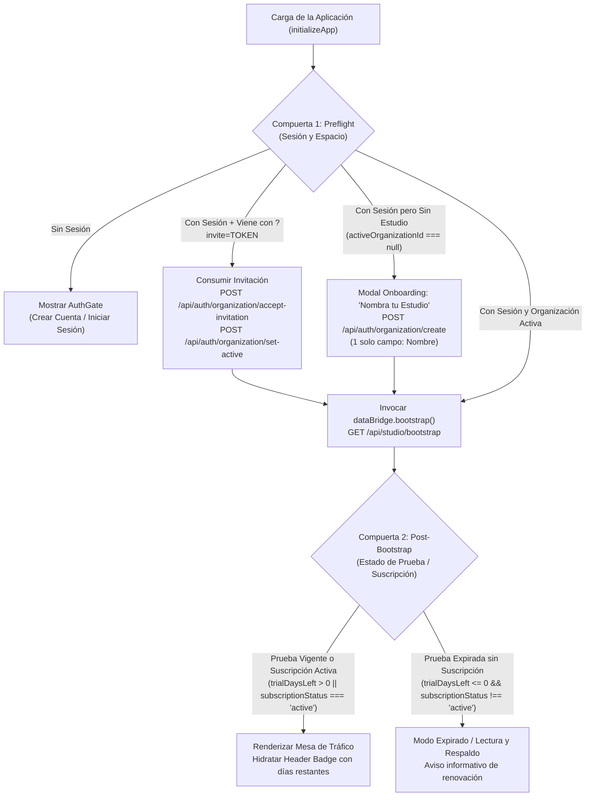

# Dictamen Consolidado de Auditoría Técnica y Arquitectura: SaaS PLG Onboarding

**Documento Evaluado:** [`docs/PLAN_SAAS_PLG_ONBOARDING.md`](file:///Users/elmarcante/Desktop/El%20Marcante%20Tr%C3%A1fico/docs/PLAN_SAAS_PLG_ONBOARDING.md)  
**Fecha de Dictamen:** 2026-11-12  
**Código Base Auditado:** `/Users/elmarcante/Desktop/El Marcante Tráfico/src`  
**Protocolo:** `/egm-review` (Preset 1: Informe Consolidado Multidisiplinar de 5 Etapas)  
**Panel Auditor:**
- **Initial & Intermediate Zoom-Out Architects** (`egm-zoom-out`): Simplicidad, YAGNI, límites de diseño y prevención de callejones sin salida.
- **Naive Comprehension Reader** (`egm-comprehension`): Claridad sin conocimiento previo asumido, resolución de acrónimos y contratos de interfaz.
- **Hostile Design Critic** (`egm-design`): Consistencia de estado, seguridad de tenancy, concurrencia y viabilidad económica.
- **Structural Layout Validator** (`egm-structural`): Jerarquía de encabezados, renderizado Mermaid y simetría de especificación.
- **Pragmatic Tech Lead & Codebase Details** (`egm-implementation-readiness`, `egm-codebase-details`): Ejecutabilidad paso a paso, contratos HTTP, integración en `src/` y prevención de regresiones.
- **Technical Copy Editor** (`egm-style`): Precisión lingüística, modo imperativo y eliminación de hipérboles.

---

## 1. Resumen Ejecutivo y Veredicto Final

> [!CAUTION]
> **VEREDICTO DE AUDITORÍA: REPROBADO CONDICIONAL (REQUIERE REFRACTOR PREVIO A LA EJECUCIÓN)**  
> Si bien la visión estratégica de adoptar un modelo **Product-Led Growth (PLG)** con *Reverse Trial* de 14 días sin fricción y 100% Better Auth nativo es plenamente acertada para Trafikeitor, el documento actual **no puede ser ejecutado tal como está redactado** debido a **4 Hallazgos Críticos (Blockers)** y **4 Hallazgos Mayores (Majors)** que causarían la falla total del sistema en producción.

### Resumen de los 4 Blockers Críticos Identificados

```
┌────────────────────────────────────────────────────────────────────────────────────────┐
│                                 LOS 4 BLOCKERS CRÍTICOS                                │
├────────────────────────────────────────────────────────────────────────────────────────┤
│ 1. PERÍODO DE PRUEBA INFINITO (FALTA DE PERSISTENCIA)                                 │
│    POST /api/auth/organization/create no guarda trial_ends_at en SQLite. Cada llamada   │
│    a bootstrap recalcula 14 días desde "ahora", por lo que el trial nunca vence.     │
├────────────────────────────────────────────────────────────────────────────────────────┤
│ 2. SUPRESIÓN SILENCIOSA DE ERRORES EN DATA BRIDGE (OMISIÓN DE data-bridge.js)          │
│    main.js no llama a bootstrap directamente. data-bridge.js atrapa 403 y 402,         │
│    degradándolos silenciosamente a "Modo Offline", impidiendo abrir el Onboarding.   │
├────────────────────────────────────────────────────────────────────────────────────────┤
│ 3. CALLEJÓN SIN SALIDA (DEAD-END) POR YAGNI EN FASE 4                                  │
│    No existe pasarela de pagos contratada (Stripe/Bold). Construir un Hard Paywall     │
│    con bloqueo 402 sin checkout secuestra los datos del cliente sin opción de pago.    │
├────────────────────────────────────────────────────────────────────────────────────────┤
│ 4. REINVENTAR LA RUEDA EN FASE 5                                                       │
│    El plan lista como "pendiente" la invitación de miembros y el flujo ?invite=TOKEN,  │
│    pero esto ya está 100% implementado y probado en modals-controller.js y main.js.    │
└────────────────────────────────────────────────────────────────────────────────────────┘
```

---

## 2. Matriz Consolidada de Trazabilidad de Hallazgos

| ID | Dimensión / Etapa | Severidad | Descripción del Hallazgo | Impacto en el Sistema |
| :---: | :--- | :---: | :--- | :--- |
| **B-01** | Arquitectura / DB (E7, E8, E9) | **Blocker** | `trial_ends_at` queda `NULL` al crear la organización en Better Auth; `bootstrap()` recalcula 14d al vuelo. | **Prueba gratuita perpetua:** la prueba jamás expira y los usuarios nunca son dirigidos al pago. |
| **B-02** | Frontend / Data Bridge (E8, E9) | **Blocker** | `src/client/data-bridge.js` fue omitido del plan; su bloque de error degrada 403 y 402 a modo offline local. | **Onboarding roto:** `main.js` jamás recibe el 403 `no_organization` y la pantalla se queda congelada. |
| **B-03** | Arquitectura / YAGNI (E5, E8) | **Blocker** | Fase 4 define un Webhook huérfano sin pasarela y un bloqueo rígido 402 sin checkout funcional. | **Callejón sin salida (Dead-end):** el usuario queda bloqueado sin poder pagar ni exportar su trabajo. |
| **B-04** | Alcance / Reinvención (E8, E9) | **Blocker** | Fase 5 planifica codificar invitaciones de equipo (`invite-member`, `?invite=TOKEN`), ya operativas al 100%. | **Trabajo redundante y riesgo de regresión** sobre código existente y probado en `modals-controller.js`. |
| **M-01** | Frontend / Caché (E9) | **Major** | `data-bridge.js` no resetea `ordersCache` si el servidor retorna `[]` (estudio nuevo), subiendo demo OTs por sync. | **Contaminación de datos:** el nuevo estudio nace lleno de órdenes demo de prueba locales. |
| **M-02** | Arquitectura / Seguridad (E7, E8) | **Major** | Plan plantea rol `Client` dentro de organizaciones Better Auth (que tiene tope estricto de 6 miembros). | **Agotamiento de asientos y fuga de datos:** clientes verían OTs confidenciales de otros clientes. |
| **M-03** | Ciclo de Vida Frontend (E7, E8) | **Major** | Guardia de Puerta evalúa `trialDaysLeft <= 0` antes de invocar `bootstrap()`, cuando solo `bootstrap` la retorna. | **Paradoja causal:** el cliente no puede evaluar días restantes antes de llamar al servidor. |
| **M-04** | Seguridad / Facturación (E9) | **Major** | `POST /api/billing/webhook` propuesto no valida firmas criptográficas ni secretos de entorno. | **Vulnerabilidad crítica:** cualquier atacante podría hacer `POST` y auto-activar suscripciones. |
| **N-01** | Renderizado Mermaid (E7) | **Nit** | Nodo `EXP` (L46) contiene `trial_ends_at < NOW` sin escapar (`<`), rompiendo el parser. | Error visual al renderizar la especificación en GitHub y visores Markdown. |
| **N-02** | Ergonomía de Formulario (E8) | **Nit** | Fase 2 incluye input manual de `slug`. | Fricción innecesaria; el slug debe ser auto-derivado en segundo plano. |
| **N-03** | Estilo Técnico (E6, E7, E9) | **Nit** | Metáforas teatrales ("Guardia de Puerta", "Bautiza tu Estudio"), verbos no imperativos y falta de YAML. | Desapego del estándar de especificaciones técnicas (`feature-spec-standard`). |

---

## 3. Análisis Técnico Profundo de los Blockers

### Blocker 1: Período de Prueba Infinito por Falta de Persistencia de `trial_ends_at`
- **Diagnóstico:** El plugin nativo `organization` de Better Auth únicamente maneja campos de su propio esquema (`id`, `name`, `slug`, `logo`, `metadata`). Al llamar a `POST /api/auth/organization/create`, los campos comerciales agregados en la migración (`subscription_status`, `trial_ends_at`, `status`) se insertan con sus valores por defecto de Drizzle. En el esquema actual:
  ```typescript
  // src/server/db/schema.ts
  trialEndsAt: integer('trial_ends_at', { mode: 'timestamp' }), // DEFAULT NULL
  ```
  Al ser `NULL`, en [`src/server/index.ts#L240`](file:///Users/elmarcante/Desktop/El%20Marcante%20Tr%C3%A1fico/src/server/index.ts#L240):
  ```typescript
  const nowSec = Math.floor(Date.now() / 1000);
  const trialEndsAt = orgRow?.trial_ends_at || (nowSec + 14 * 86400);
  ```
  Cada petición recalcula 14 días a partir del momento exacto de la llamada. Como jamás se guarda en la base de datos, `trialDaysLeft` siempre será 14 y `trial_ends_at < NOW` jamás será verdadero.
- **Remediación Requerida:**  
  Configurar el hook de ciclo de vida nativo de Better Auth en [`src/server/auth.ts`](file:///Users/elmarcante/Desktop/El%20Marcante%20Tr%C3%A1fico/src/server/auth.ts):
  ```typescript
  databaseHooks: {
    organization: {
      create: {
        before: async (org) => {
          const trialEndsAt = new Date(Date.now() + 14 * 86400 * 1000);
          return {
            data: {
              ...org,
              subscriptionStatus: 'trialing',
              trialEndsAt,
              status: 'active',
            },
          };
        },
      },
    },
  }
  ```

---

### Blocker 2: Supresión Silenciosa de Errores en `src/client/data-bridge.js`
- **Diagnóstico:** El plan asume que `main.js` invoca a la API y atrapa los códigos `403` y `402`. En Trafikeitor, toda la comunicación HTTP reside en `src/client/data-bridge.js`. Actualmente, las líneas 569–573 de `data-bridge.js` hacen:
  ```javascript
  // Si la respuesta no fue ok, operamos con la caché local
  emit('sync:status', { isSaving: false, text: 'Modo Offline (Local)' });
  emit('data:ready', { source: 'local', user: null });
  return { ok: true, source: 'local', user: null };
  ```
  Esto suprime el 403 `no_organization` y lo disfraza de "Modo Offline". `main.js` nunca recibe el evento ni el error, por lo que el modal de onboarding nunca se muestra.
- **Remediación Requerida:**  
  Actualizar `src/client/data-bridge.js` en las Fases 2 y 4:
  1. En `bootstrap()`: detectar `res.status === 403` con `{ error: 'no_organization' }`, retener la identidad del usuario y despachar `emit('auth:no-organization', { user })`.
  2. En `scheduleSync()`: ante `res.status === 402`, despachar `emit('billing:trial-expired')`.
  3. En `main.js`: escuchar `on('auth:no-organization')` para abrir el modal de Onboarding.

---

### Blocker 3: Callejón sin Salida (Dead-End) por YAGNI en Fase 4
- **Diagnóstico:** El repositorio no cuenta con pasarela de pagos contratada (ni Stripe, ni Bold, ni MercadoPago), ni endpoints de checkout. Implementar un "Hard Paywall" que devuelva `402 Payment Required` y bloquee el guardado de OTs deja a la agencia en un limbo operativo: sus 14 días vencen y no tiene ninguna pantalla ni botón real para pagar con tarjeta, perdiendo el acceso a su información de producción.
- **Remediación Requerida (Right-Sizing):**  
  - **Desacoplar la pasarela:** Extraer la integración de Webhooks y pasarelas de pago del hito de Onboarding PLG, trasladándolo a una especificación dedicada (*Billing & Monetization Milestone*) una vez se seleccione y contrate la pasarela.
  - **Expiración de solo lectura para el MVP:** Al vencer la prueba (`trialDaysLeft <= 0`), mostrar un estado de advertencia informativo con opción de contacto comercial, permitiendo siempre la consulta y la exportación de respaldos de datos (`exportBackupData()`).

---

### Blocker 4: Reinvención de la Rueda en Fase 5
- **Diagnóstico:** La Fase 5 propone implementar la invitación de miembros por correo, la generación de enlaces `?invite=${invitationId}` y la aceptación automática con `accept-invitation` y `set-active`.
  Al auditar el código fuente, **esta funcionalidad ya se encuentra 100% implementada y probada**:
  - [`src/client/modals-controller.js#L2473-L2535`](file:///Users/elmarcante/Desktop/El%20Marcante%20Tr%C3%A1fico/src/client/modals-controller.js#L2473-L2535): funciones `handleSendTeamInvite`, `handleCopyTeamInviteLink` y `handleCancelTeamInvite`.
  - [`src/client/main.js#L421-L463, #L666-L692`](file:///Users/elmarcante/Desktop/El%20Marcante%20Tr%C3%A1fico/src/client/main.js#L421-L463): detección de `?invite=TOKEN`, aviso visual y consumo de `accept-invitation` y `set-active`.
  - [`index.html#L1934-L1981`](file:///Users/elmarcante/Desktop/El%20Marcante%20Tr%C3%A1fico/index.html#L1934-L1981): markup completo del modal de equipo.
- **Remediación Requerida:**  
  Marcar la Fase 5 como `[x] (Completada y Verificada)` idéntica a la Fase 1. Retirarla del backlog activo para no desperdiciar esfuerzo ni introducir regresiones.

---

## 4. Reingeniería del Front-Controller y Flujo de Usuario

Para resolver la paradoja causal (M-03) y la ruptura de navegación para usuarios invitados (H7-M01), el ciclo de vida de arranque en el cliente (`initializeApp()`) debe estructurarse en **dos compuertas nítidas y secuenciales**:



---

## 5. Plan de Acción Recomendado para Refactorizar `docs/PLAN_SAAS_PLG_ONBOARDING.md`

Para transformar `docs/PLAN_SAAS_PLG_ONBOARDING.md` en un documento ejecutable y blindado, se deben aplicar las siguientes modificaciones estructurales:

1. **Encabezado y Metadatos:**
   Incorporar bloque YAML con `Standard: feature-spec-standard`, `Status: In Review -> Ready for Refactor`, `Target: PLG Onboarding MVP`.
2. **Sección 1 (Visión y Principios):**
   - Incorporar `POST /api/auth/organization/set-active` a la lista de APIs nativas de Better Auth.
   - Aclarar que Better Auth gestiona exclusivamente usuarios internos de la agencia (`max = 6`). El acceso a clientes externos se realiza mediante tokens públicos de revisión (`shared_reviews` / `/api/public/review/:token`).
3. **Sección 2 (Flujo en 4 Pasos y Diagrama Mermaid):**
   - Corregir el nodo `EXP` reemplazando `<` por `&lt;`.
   - Incorporar la bifurcación de usuarios invitados con `?invite=TOKEN` directo hacia la aceptación sin pasar por onboarding.
4. **Sección 3 (Matriz de Control de Acceso del Front-Controller):**
   - Reemplazar el nombre informal *"La Regla de Oro del Guardia de Puerta"* por *"Matriz de Control de Acceso y Redirección (Front-Controller)"*.
   - Separar la tabla en dos compuertas: Compuerta Preflight (Sesión, Invite, Organización) y Compuerta Post-Bootstrap (Suscripción y Días Restantes).
   - Corregir la condición de expiración: `subscriptionStatus !== 'active' && trialDaysLeft <= 0` (eliminando la referencia ambigua a `status`).
5. **Sección 4 (Fases de Implementación):**
   - **Fase 1:** Añadir como ítem completado el hook de Better Auth (`databaseHooks.organization.create.before`) para garantizar la persistencia de `trial_ends_at` en base de datos.
   - **Fase 2 (Onboarding):**
     - Reducir el formulario modal a **1 solo campo: "Nombre de tu Estudio"** (slug auto-derivado en background).
     - Incorporar explícitamente `[Modify] src/client/data-bridge.js` para propagar el evento `auth:no-organization` y resetear `ordersCache = []` si el estudio es nuevo.
     - Documentar que el modal de onboarding no se puede cerrar con tecla `Escape` ni clic fuera.
   - **Fase 3 (Header Badge):**
     - Vincular el badge a los datos recibidos de `bootstrap()`.
     - Definir el modal de suscripción en `src/client/modals-controller.js` con botón de contacto/soporte para la activación.
   - **Fase 4 (Expiración / Hard Paywall):**
     - Desacoplar el webhook de pasarela de pago (posponerlo a un hito comercial específico).
     - Establecer el modo de prueba expirada con acceso de solo lectura y botón de descarga de respaldo de datos.
   - **Fase 5 (Invitaciones de Equipo):**
     - Marcar como `[x] (Completada y Verificada)`.
6. **Sección 5 (Matriz de Roles):**
   - Eliminar el rol `Client` de la tabla de organizaciones Better Auth.
   - Mantener exclusivamente `Owner` (1) y `Member` (hasta 5 adicionales).
7. **Sección 6 (Criterios de Aceptación y Verificación):**
   - Incorporar una suite de pruebas automatizadas ejecutables con `npx tsx` (`scripts/verify-plg-flow.ts`) que valide:
     1. Registro público abierto.
     2. Retorno `403 error: 'no_organization'` antes de crear el estudio.
     3. Creación de estudio con persistencia efectiva de `trial_ends_at` en SQLite.
     4. Bootstrap exitoso con 14 días restantes y sincronización de órdenes sin fugas de caché demo.
     5. Simulación de expiración y despliegue del estado de solo lectura.

---

## 6. Referencia a los Informes de Detalle

Para consultar el análisis detallado de cada dimensión, revise los informes parciales generados en el directorio [`docs/reviews/plan_saas_plg/`](file:///Users/elmarcante/Desktop/El%20Marcante%20Tr%C3%A1fico/docs/reviews/plan_saas_plg/):
- **Visión General y YAGNI Inicial (Etapa 5):** [`zoom_out_report.md`](file:///Users/elmarcante/Desktop/El%20Marcante%20Tr%C3%A1fico/docs/reviews/plan_saas_plg/zoom_out_report.md)
- **Comprensión sin Conocimiento Previo (Etapa 6):** [`comprehension_report.md`](file:///Users/elmarcante/Desktop/El%20Marcante%20Tr%C3%A1fico/docs/reviews/plan_saas_plg/comprehension_report.md)
- **Crítica de Arquitectura, Estructura y Estilo (Etapa 7):** [`critic_report.md`](file:///Users/elmarcante/Desktop/El%20Marcante%20Tr%C3%A1fico/docs/reviews/plan_saas_plg/critic_report.md)
- **Dictamen de Simplicidad Arquitectónica (Etapa 8):** [`intermediate_zoom_out_report.md`](file:///Users/elmarcante/Desktop/El%20Marcante%20Tr%C3%A1fico/docs/reviews/plan_saas_plg/intermediate_zoom_out_report.md)
- **Preparación de Implementación y Código (Etapa 9):** [`implementation_readiness_report.md`](file:///Users/elmarcante/Desktop/El%20Marcante%20Tr%C3%A1fico/docs/reviews/plan_saas_plg/implementation_readiness_report.md)

